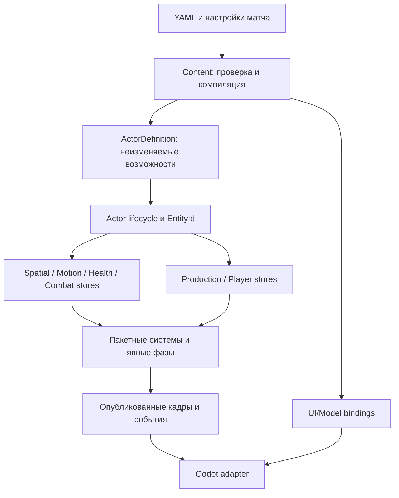

# Actor, определения, traits и ECS в OpenRTS

> Обновление2026-11-05: по уточнённому требованию пользователя выбрана готовая ECS библиотека. Рекомендации сначала создавать собственные stores и отложить ECS-пилот заменены [выбором Frent](../ecs-selection/README.md) и [новым планом](../ecs-selection/migration.md). Ниже сохранён исходный анализ; runtime по нему не мигрировал.

Дата: 2026-11-05. **Статус: рекомендация для обсуждения, не принятый ADR и не выполненная миграция.** Задача — выбрать основу перед Player/экономикой и дальнейшим ростом игровых механик. [План перехода](migration.md), [источники и снимок локального кода](sources.json).

## Рекомендация

Стоит выделить общую концепцию Actor и провести ограниченный рефакторинг сейчас. Выбранное направление для обсуждения: **композиция определений как у traits + раздельные runtime-состояния + пакетные системы**, с сохранением существующих численных правил, навигации и границ Godot.

Actor означает общую идентичность, жизненный цикл и набор возможностей. Он не обязан быть C# суперклассом с виртуальными Update/Move/Attack. Unit, Building и PlayerActor — разные сборки возможностей. Универсальная идентичность уже начинается с EntityId; вводить второй почти такой же ActorId только ради переименования не требуется.

Переход на готовый archetype ECS остаётся допустимым вариантом, а не архитектурной ошибкой. Однако сейчас подтверждена прежде всего потребность в разделении ответственности. Превращать этот этап в разработку собственного универсального ECS или немедленную замену всех хранилищ библиотекой оснований недостаточно. Для выбора backend нужен сопоставимый пилот, а не число звёзд или синтетический benchmark поставщика.

## Что есть сейчас

Статический разбор текущего рабочего дерева: 38 C# файлов Core без bin/obj; SimulationWorld занимает12 partial-файлов и1885 строк, EntityState содержит39 полей. Эти числа воспроизводятся по источникам, но **не являются оценкой качества или замером памяти/скорости**. В рабочем дереве присутствует локальная правка форматирования Production; она включена в снимок и не изменялась этим исследованием.

| Наблюдение | Конкретное место | Вывод |
| --- | --- | --- |
| Definitions и состояние уже разделены | UnitDefinition.MaxHealth/Weapons против EntityState.Health/WeaponState | Разделение не нужно создавать заново. Его следует сделать систематическим и убрать ограничения «всё — боевой юнит» |
| YAML отсутствует в Core | UnitCatalog компилирует typed definitions, UI bindings отдельно | Эту границу сохраняем |
| Монолитное runtime-состояние | EntityState включает движение, очередь приказов, оружие, ожидания, направления, анимации | Для Player без позиции и здоровья нет естественного пути создания через текущую модель |
| Общая область private-доступа | Все12 частей SimulationWorld — один класс | partial группирует файлы, но не ограничивает зависимости и право записи |
| Производство уже имеет отдельное состояние | ProducerState хранится только для производителей, по EntityId | Это полезный пример специализированного хранилища. Однако его update всё ещё напрямую использует сущности, Spawn, пути, приказы и представление того же класса |
| Способности привязаны к оружию | AbilityMount, WeaponState.ReadyTick/AutoCast, AbilityInRange | Для гранаты/ремонта достаточно; способность игрока «начать исследование» не должна требовать фиктивного оружия |
| Компиляция игровых действий начинается в UI-подобном блоке | UnitCatalog создаёт AbilityDefinition/ProductionDefinition из Actions.Buttons | Label/Hotkey действительно исключены из fingerprint, но удаление всей кнопки удалит и игровое действие. Направление зависимости стоит исправить |
| Каждый actor сейчас считается объектом карты | AddInitialUnit проверяет позицию; RebuildMotionIndex и CopyPoses обходят все сущности | Player нельзя добавлять как юнит с HP=1 и позицией(0,0); нужны выборки по наличию возможностей |
| DeclarativeContent имеет TraitRegistry | В UnitCatalog фабрики возвращают options, затем собирается UnitDefinition | Это инфраструктура загрузки/композиции, **не** готовый runtime traits/ECS |

Итого: текущая реализация подходит для работающего прототипа и сохраняет важные гарантии. Но продолжать расширять один EntityState и общий private-контекст всеми следующими системами — риск растущей связанности. Новое имя Actor само по себе этот риск не устранит.

## Что показывают референсы

**OpenRA.** Actor — sealed контейнер с ActorInfo и создаваемыми runtime traits. Player — отдельный класс с PlayerActor, World — отдельный класс с WorldActor. Это не иерархия `Player : Actor` и `World : Actor`. ActorInfo проверяет зависимости и порядок создания trait; World отдельно задаёт обновление activities, ITick и отложенные изменения. Значит, порядок конструирования нельзя подменять порядком игровых фаз. Источники: [Actor](https://github.com/OpenRA/OpenRA/blob/9636b63eaee62fcb60ef2e896e7985bdf2f1ee68/OpenRA.Game/Actor.cs), [ActorInfo](https://github.com/OpenRA/OpenRA/blob/9636b63eaee62fcb60ef2e896e7985bdf2f1ee68/OpenRA.Game/GameRules/ActorInfo.cs), [Player](https://github.com/OpenRA/OpenRA/blob/bleed/OpenRA.Game/Player.cs), [World](https://github.com/OpenRA/OpenRA/blob/9636b63eaee62fcb60ef2e896e7985bdf2f1ee68/OpenRA.Game/World.cs), [interfaces](https://github.com/OpenRA/OpenRA/blob/bleed/OpenRA.Game/Traits/TraitsInterfaces.cs).

**0 A.D.** PlayerManager создаёт player entity по template и хранит соответствие номера игрока и entity ID. Player component разделяет template-параметры и живые ресурсы/популяцию/статус. ComponentManager содержит отдельную регистрацию native/script компонентов, сообщения и system entity со специализированными менеджерами. Компонентная композиция здесь не означает обязательное archetype/SoA хранение: наблюдаемый менеджер использует выделяемые компоненты и maps. Источники: [PlayerManager](https://github.com/0ad/0ad/blob/master/binaries/data/mods/public/simulation/components/PlayerManager.js), [Player](https://github.com/0ad/0ad/blob/master/binaries/data/mods/public/simulation/components/Player.js), [ComponentManager](https://github.com/0ad/0ad/blob/master/source/simulation2/system/ComponentManager.cpp). Это архивный mirror, не проверка последней версии upstream.

**Arch.** Официальная документация C# ECS описывает маленькую entity-идентичность, компоненты, запросы и archetype/chunk хранение, а также CommandBuffer для отложенных изменений. Готовая библиотека может снять работу по storage/query-инфраструктуре; она не определяет правила боя, оплаты, ID порядка и hash нашего движка. Размеры chunks в документации и README расходятся, поэтому конкретные размеры и показатели производительности здесь не используются. Источники: [Concepts](https://arch-ecs.gitbook.io/arch/documentation/concepts), [репозиторий](https://github.com/genaray/Arch).

**Flecs.** Entity может представлять игрока и не обязана содержать пространственное состояние. Табличная композиция отделена от систем. При staging структурные операции откладываются, но запись существующих компонентных данных остаётся возможной. Это пример того, почему использование ECS не отменяет контрактов фаз и записи: момент применения Spawn/Destroy имеет игровые последствия. Источники: [Entities and Components](https://www.flecs.dev/flecs/EntitiesComponents.html), [Systems / Staging](https://www.flecs.dev/flecs/Systems.html). Документация описывает Flecs4.2; библиотека в OpenRTS не подключалась.

Эти наблюдения поддерживают разделение **идентичности, композиции, хранения и исполнения**. Они не доказывают, что один из движков быстрее нашего или что конкретная библиотека автоматически сохранит детерминизм OpenRTS.

## Сравнение вариантов

| Вариант | Сильная сторона | Цена/риск для OpenRTS | Оценка |
| --- | --- | --- | --- |
| Оставить текущую модель, продолжать partial | Минимум изменений | Общая структура и скрытые зависимости растут, Player требует особых случаев | Оставить как переходную реализацию, не как окончательное устройство |
| Глубокая иерархия Actor → Unit/Building/Player | Привычный объектный API | Общие поля оказываются неподходящими; строитель/ремонтник/производитель пересекают ветви наследования | Не рекомендую в качестве основы игровых возможностей |
| Полные runtime traits в стиле OpenRA | Удобная сборка возможностей и расширение C# поведением | Нужны lifecycle, зависимости, безопасные ссылки, порядок уведомлений и регистрация; `GetTrait<T>` не решает связанность | Использовать идеи композиции/контрактов, без автоматического per-trait Tick для массовых систем |
| Готовый archetype ECS | Storage/query/membership и часть tooling предоставляет библиотека | Миграция lifecycle/ID/ссылок, структурных изменений и сериализации; бизнес-системы всё равно проектируем сами | Возможный backend после ограниченного пилота |
| Конкретные компонентные состояния и пакетные системы | Совместимо с текущими массивами, пространственными индексами и редкими ProducerState | Дисциплину зависимостей и lifecycle придётся явно обеспечивать | Рекомендуемый ближайший шаг |

Компонент — единица связного состояния и владения, а не обязательно один скаляр. Не нужно заранее дробить Position на X/Y или создавать десятки однотипных интерфейсов. И не нужно заранее запрещать class-состояния: несколько сложных Producer/Player объектов могут храниться иначе, чем десятки тысяч Motion/Weapon записей. Объектный фасад для редактора также совместим с пакетным исполнением — он не обязан владеть копией состояния.

## Целевая модель

**Actor identity.** Реестр отвечает за существование, определение и жизненный цикл. EntityId сохраняется как устойчивая ссылка; индекс плотного массива им не является. Общий Actor/ActorRef API при необходимости может быть тонким view над World+ID. Он не хранит ещё одну копию HP/позиции, не передаётся в Godot как изменяемый объект и не гарантирует валидность `ref` после структурных изменений. Пока ID не переиспользуются, не требуется вводить поколения просто ради нового термина.

**ActorDefinition.** Typed immutable набор начальных возможностей и ссылок на их определения. Health/Spatial/Movement/Production/Player capabilities необязательны; их зависимости проверяются при компиляции. Рабочий план типа разрешает имена/instance keys в стабильные индексы, валидирует сборку и определяет, какие runtime-хранилища инициализируются. Core не получает YAML-ноды. Объявление Player может собираться и из настроек матча, без обязательного фиктивного YAML юнита.

**Runtime state.** HealthState.HP, WeaponState.ReadyTick, ProductionState.Tasks, PlayerState.Resources живут у конкретного актора. Инициализируются из definition, но не записывают новые значения обратно в общий шаблон. Ускорение производства/исследование изменяет effective stats/модификаторы, а не UnitDefinition всех игроков. Политика дальнейших обновлений определения во время матча отдельно не обещается.

**Systems.** Movement обновляет выбранные подвижные состояния, Combat — вооружённые, Production — производителей. Поведение не выбирается цепочкой `if ActorKind == Player`. Registry и stores отвечают за membership/lifetime, а конструктор типа — за валидность сочетания возможностей. Часто используемые данные выбираются заранее, а не ищутся reflection/Dictionary<Type,object> на каждом шаге каждого юнита.

**Игра и управление игроком.** PlayerId — участник/сторона матча, EntityId — игровая сущность. Между ними явное соответствие. PlayerActor может получить ресурсы, технологии, лимиты и дипломатию. Он не обязан иметь Health/Transform/Locomotor. Оболочка Player может связывать actor с контроллером человека/AI; аккаунт, сетевое соединение и локальный UI остаются вне authoritative actor state.

| Сборка | Возможности, которые ей действительно нужны |
| --- | --- |
| Пехотинец | Spatial, Health, Movement, Orders, Weapons/Abilities, Ownership, семантика представления |
| Завод | Spatial, Footprint, Health, Production, Ownership, семантика представления; Movement не требуется |
| PlayerActor | Resources, Research, Population/Diplomacy по потребности; позиция и здоровье не требуются |

World не обязан быть actor, чтобы иметь общие сервисы. Снаряды могут остаться компактным специализированным пулом, а визуальные искры — полностью в адаптере. Общая основа для игровых объектов не требует превращать каждый временный эффект в отдельный heavyweight actor.

## Что действительно предотвращает связанность

1. **Единственный владелец записи.** У систем конкретные stores/результаты и понятные права записи. `System.Tick(SimulationWorld everything)` с полным доступом ко всем полям просто перенесёт монолит в другие файлы.
2. **Небольшие реальные зависимости.** Production получает определения/очереди, проверку выхода и lifecycle-запросы; Combat — нужные пространственные/health данные. Не вводить десятки пустых интерфейсов вместо работающих модулей и не заменять все зависимости ServiceLocator.
3. **Явные фазы и барьеры.** Приказы → движение → бой/смерти → производство → представление остаются проверяемым контрактом. Spawn/Destroy/изменение footprint применяются в назначенных точках. Перенос всех изменений в единый конец тика изменит, например, выпуск продукта погибшим производителем и взаимную занятость выходов.
4. **Уведомления отдельно от authority.** Facts/events полезны для независимых подписчиков. Урон, списание и выдача EntityId не должны скрываться в произвольно упорядоченной цепочке callbacks общего event bus.
5. **Стабильные определения и порядок.** Feature/instance IDs, команды, конфликты, RNG и канонический hash не зависят от Dictionary, порядка dense/archetype-пула или завершения worker. Порядок создания traits не заменяет порядок systems.
6. **Пространственное представление — выборка.** Player не проходит через MotionIndex, рендер юнитов, selection и сбор footprint. UI получает отдельные Player snapshot данные в рамках того же протокола владения кадром, когда такие данные появятся.

## Чего этот рефакторинг не обещает

Он уменьшает число мест, которые нужно менять при добавлении возможностей, но не автоматически увеличивает FPS. Данные могут оставаться AoS, SoA или sparse-хранилищами в зависимости от профиля. Глобальную инвалидацию N2, холодное построение clearance и заторы нельзя объявить решёнными после смены EntityState на ECS.

Внешние движки не запускались; сравнительных замеров и миграции нет. Производственные/навигационные проверки из существующих отчётов используются как будущие регрессионные критерии, а не как новый результат этого исследования. Архитектура остаётся предложением; конкретный первый срез и критерии приведены в [migration.md](migration.md).
