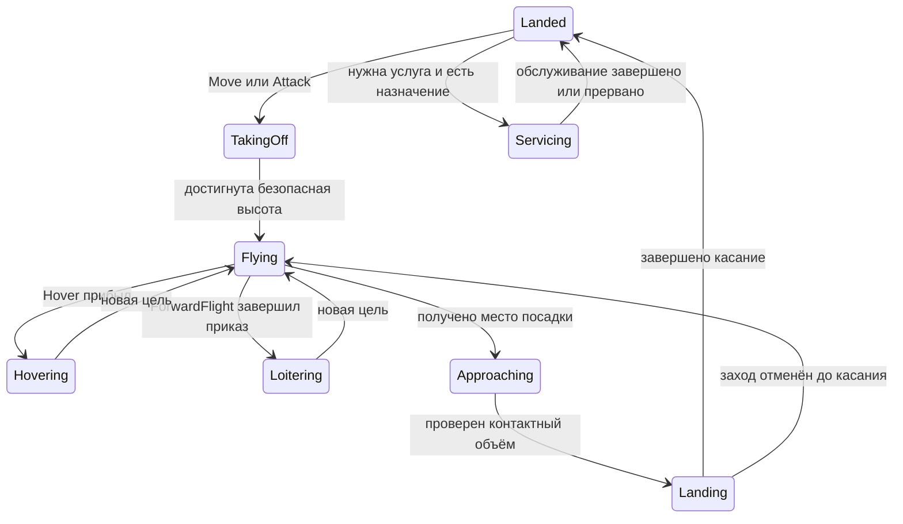

# Предлагаемая модель авиации OpenRTS

9 ноября 2026 года. Исходный проект целевой механики. После согласования появился [первый реализованный вариант](../../decisions/032-aviation-and-target-categories.md), охватывающий части A0–A5 с ограниченной областью. Полный план ниже не объявлен выполненным. [Фактические проверки](../../verification/032-aviation.md). Основания референсов — в [разборе исходников](sources.md), общий вывод — в [обзоре](README.md).

## Назначение и границы

Первый потребитель — спрайтовая RTS OpenRTS.CnC. База должна позволять сделать также вертолёты Generals, транспорт и самолёты с повторными заходами. Требуется управляемость RTS, а не авиасимулятор. Реализация ограничивается полётом над одной наземной поверхностью и явными посадочными точками. Тоннели, полёт под мостами, произвольные воздушные коридоры и палубы движущихся авианосцев потребуют дополнительных контрактов.

Это расширение Gameplay. [Core/GamePlay](../../decisions/023-core-and-gameplay.md) остаются независимыми по прежнему направлению зависимостей. [Планировщик наземных маршрутов](../../decisions/028-navigation-route-planner.md) не становится общим авиационным решателем. [Многослойные наземные поверхности](../navigation-layers/roadmap.md) остаются отдельным направлением. Понадобится новое принятое решение о воздушных взаимодействиях до включения механики по умолчанию.

## Выбор среди вариантов

| Вариант | Польза | Цена и ограничения | Предложение |
| --- | --- | --- | --- |
| Наземный Locomotor с Traverse везде и высоким спрайтом | Небольшое видимое изменение | Сохраняет наземную занятость, точную остановку самолёта и плоское попадание | Не использовать как основу игровой авиации |
| Управляемый полёт 2.5D с независимым Z | Подходит спрайтам, сохраняет точные X/Y и фиксированный тик | Нужно явно описать высоту, контакт, категории целей и посадку | Основной вариант |
| Физическая модель с силами и управляющими поверхностями | Богатые манёвры, ближе к Recoil | Больше параметров, сложнее настройка, воспроизводимость и групповой контроль | Отложить до реального потребителя |
| Отдельные слои клеток LowAir/HighAir | Простые некоторые фильтры | Плохо описывают набор/снижение и пересекающиеся по времени траектории | Можно добавить как игровые категории, не заменять ими координату высоты |

Общую конфигурацию полёта предлагается разделить на режим горизонтального движения и способ старта/посадки. На первом этапе достаточно конкретных значений Hover/ForwardFlight и Vertical. Runway появляется вместе с потребителем A5. Не создавать заранее интерфейсы для всех возможных физических движков.

## Контракты

**T1. Один актор.** Взлёт, полёт, зависание, посадка и обслуживание сохраняют EntityId, здоровье, владельца, cooldown и боезапас. Превращение в другую сущность с новым ID остаётся отдельной механикой. Отмена приказа не восстанавливает потраченное и не обнуляет таймеры.

**T2. Раздельные режимы взаимодействия.** Летящий аппарат не блокирует наземную навигацию и размещение своим X/Y. Он остаётся доступен выбору и воздушному оружию. Приземлённый аппарат имеет наземное физическое тело и выбранную игрой категорию целей. «Воздушная цель», «участник раздвигания» и «занимает землю» — независимые факты, а не один флаг, читаемый всеми системами.

**T3. Переход без наложения.** Снижение в контактную зону возможно только после проверки и захвата места. Пока аппарат находится близко к поверхности, его фактический объём учитывается в столкновениях с землёй. Проверка конечного положения не заменяет проверку межтикового движения. При неудаче аппарат ждёт или уходит на повторный заход без телепортации.

**T4. Два исполнения Move.** Hover приходит в точную допустимую X/Y и тормозит до нуля. ForwardFlight подтверждает прохождение области цели, продолжает движение и при отсутствии следующего приказа переходит в круг ожидания. Наземный Move сохраняет прежний контракт. Stop очищает намерение и очередь, но для самолёта означает безопасное кружение. Hold прекращает самостоятельное преследование, сохраняя физически допустимый режим. Ни одна команда не должна замораживать самолёт в воздухе.

**T5. Высота авторитетна.** Текущее абсолютное положение хранится в `SpatialState.Position.Elevation`, предыдущее — в Previous. В состоянии полёта хранятся только желаемая высота, вертикальная скорость/остатки и фаза, без второй изменяемой копии фактического Z. Высота над грунтом вычисляется из текущей поверхности. Все расстояния — в мировых fixed-point единицах, времена — в тиках. Внутреннее имя свойства Elevation можно сохранить, но его авиационный смысл нужно задокументировать и проверить на существующих потребителях.

**T6. Допустимость цели едина и расширяема.** По уточнению пользователя категории задаются именованными наборами без закрытого Ground/Air enum. Игра может выделять вертолёты, самолёты, надводные и подводные объекты и другие категории. Они проверяются при ручном приказе, автопоиске, выстреле и применении эффекта. Высота не превращает танк на горе в Air. Боевой режим самолёта определяется состоянием полёта и контактом относительно посадочной поверхности. Для площадки над грунтом нужен явный datum.

**T7. Детерминизм.** Все игровые фазы, скорости, остатки, намерения и резервации входят в hash. Конфигурация полёта/боеприпасов влияет на fingerprint. Спрайты, bobbing, вид ротора, визуальный roll и тень — нет. Выбор равных кандидатов и конфликтов задаётся по domain ID и стабильным номерам мест. Рабочие потоки не определяют победителя.

Область T1–T5 и T7 — A1 и последующие этапы. T6 и полноценные высотные попадания обязательны до игрового боевого сценария A2. A1 можно проверять как небоевой стенд, но нельзя объявлять готовой боевой авиацией.

## Данные и ответственность

Нужны immutable параметры полёта в definitions и компонент состояния только у аппаратов. Состав компонента определяется первым прототипом, предполагаемые данные — фаза, текущая горизонтальная скорость, вертикальная скорость, остатки вычисления, желаемая высота, точка ожидания и намерение посадки. Фактическая позиция остаётся в SpatialState, HP — в HealthState, владелец — в OwnershipState. Носитель по-прежнему владеет пассажирами через Transport.

Для Hover минимальны скорость, разгон/торможение, скорость поворота, скорость набора/снижения, крейсерская высота и разрешение бокового движения. Для ForwardFlight понадобятся минимальная/крейсерская скорость, поворот, область завершения waypoint и параметры захода/ожидания. Нельзя независимо назначить несовместимые скорость, радиус ожидания и поворот. Content должен отклонять физически невозможную настройку либо документированно вычислять радиус из скорости и поворота. Точную дискретную границу проверяет прототип.

Земля и аппарат имеют независимые физические размеры. Model.Size не задаёт тело, зазор, высоту препятствия или радиус попадания. Если A2 использует вертикальные объёмы, их размер входит в gameplay definition. У старых definitions остаются нынешние наземные значения и прежний результат наземных проверок.

Пример жизненного цикла, а не готовый enum API.

Смерть доступна из любой фазы, окончательно закрывает приказы и освобождает назначения. Отдельное разрушение в полёте рассматривается ниже. Фазы обслуживания и возврата не следует без необходимости перемножать с каждой фазой полёта в один большой enum.

## Исполнение тика и воздушное движение

**Назначение.** Получить новое положение к фазе боя, сохранив нынешний порядок основных фаз `SimulationWorld.Update`. Следующая последовательность — предложение, требующее проверки A0.

1. Применить команды и изменения мира в существующем каноническом порядке. Зафиксировать Previous для всех акторов. Обновить запросы движения и посадки. Отклонённая замена приказа сохраняет прежнюю очередь.
2. Разделить наземных и воздушных получателей движения. Совместный Move/AttackMove не отправляет самолёты в компактные наземные назначения. Для воздуха определить свои разнесённые цели или центры ожидания. Порядок распределения стабилен.
3. На снимке начала движения вычислить желаемые воздушные шаги. Для Hover разгоняться/тормозить с ограничением, перед близкой целью уменьшать скорость и точно завершать X/Y. Допуск бокового движения отделяет скорость от направления корпуса.
4. Для ForwardFlight повернуть heading не больше разрешённого угла, выполнить движение вперёд с ненулевой скоростью. При слишком близкой недостижимой точке выбрать дополнительный выход/подход, а не уменьшать скорость до нуля. Признак прохождения waypoint проверять по отрезку движения и области допуска, чтобы быстрый аппарат не пропускал цель между тиками.
5. Рассчитать желаемый Z и ограниченный набор/снижение. Учесть безопасную высоту впереди на выбранном горизонте, а не только terrain под текущим центром. Крутой склон не должен внезапно пересечь тело. Для первой реализации допустимо ограничить карты и скорость, но ограничение должно валидироваться.
6. Выполнить местное раздвигание по соседям. Использовать бины X/Y с вертикальным фильтром и стабильным порядком кандидатов. В совпадающей позиции направление выбирать из пары ID, а не из порядка выдачи query. Сила ограничена. ForwardFlight корректирует курс, сохраняя минимальную скорость. Это мягкое избегание, не обещание бесконтактного полёта.
7. Разрешить конфликты в контактной зоне в определённом порядке, применить наземное и воздушное движение. Принятые траектории доступны проверкам оставшихся участников. Выбор конкретного межфазного алгоритма — задача A0. Он должен учитывать относительные swept-траектории, а не последовательно проверять только неподвижные endpoints.
8. Зафиксировать переходы контакта и категории целей, обновить производные индексы. Только затем запускать существующий бой. Повреждённые/уничтоженные объекты не получают услуги позднее в том же тике. Новые выпуск и производство не исполняют собственное движение задним числом.

Полёт нельзя добавить только правилом конца тика: в текущем мире оружие уже отработает на старой позиции, а наземное движение успеет обработать аппарат. Нужны явная точка исполнения движения и корректные фильтры существующих систем. Регистрация сменного контроллера имеет смысл после появления второго реально используемого исполнения, а не как предварительная универсальная иерархия.

Направление корпуса требует отдельного внимания. Сейчас наземное представление отражает перемещение и отдельное Aim. Hover с движением боком должен публиковать авторитетный yaw, используемый оружием, независимо от вектора скорости. Адаптер выбирает нужный ракурс спрайта, не вращая исходную CnC текстуру. Визуальные наклон, дрожание и ротор не меняют результат наведения.

### Высота и препятствия

Для A1 предлагается полёт на заданной высоте над единственной поверхностью с ограниченной вертикальной скоростью. Стены и здания не становятся бесконечно высокими колоннами из-за наземной маски Traverse. До поддержки их высоты крейсерская авиация по объявленному правилу перелетает наземные blockers, а посадка проверяет их тела. Это ограничение первой модели, а не физическое доказательство безопасности любых карт.

Если игра требует горы, высокие здания или бесполётные зоны, нужны дополнительные данные. Высоту физического препятствия следует хранить отдельно от его рисунка. Участок проверяется по полной траектории и высоте. Если вертикального зазора нет, аппарат должен заранее набрать высоту или получить отказ/новый маршрут. Остановка ForwardFlight перед стеной недопустима. Без гарантируемого манёвра Content/сценарий ограничивает такие карты. Обход зон и air pathfinding вводить с этим потребителем, без изменения семантики наземного terrain.

## Посадка и взлёт

**Входы.** Аппарат, целевая позиция или EntityId площадки, требуемые услуги, тип посадки, текущая ревизия цели. **Выход.** Подход, ожидание, успешный контакт или отказ с сохранением безопасного режима. Наземная посадка и посадка на площадку используют общие проверки тела, но площадка имеет собственную отметку и разрешённый контакт.

1. Проверить совместимость, владельца, готовность базы и допустимую поверхность. Для площадки выбрать стабильный SlotId. Вместимость означает физически разные места, а не число в интерфейсе.
2. Записать намерение или запрос обслуживания. Дальний подход не блокирует проход наземных юнитов. У площадки допустима логическая резервация, но она не делает весь footprint базы эксклюзивным воздушным пространством.
3. Перед финальным снижением повторно проверить базу, положение, услуги, точное тело и контактную траекторию. При конфликте с другой посадкой победитель определяется временем запроса, затем EntityId. Занятую землю нельзя «продавить» одной сменой режима.
4. На время финального контакта захватить небольшой объём посадки и включить его в проверки наземного движения, спавна, размещения и других посадок. Проверка не должна требовать глобального terrain stamp и перестройки всех наземных полей. Можно использовать динамическую геометрию, но покрытие всех операций нужно проверить отдельно.
5. Для своего или нейтрального подвижного блокировщика можно запросить ограниченное уступание через имеющуюся механику. Для остальных препятствий — ожидание или отказ. Воздушное ожидание не должно создавать бесконечное взаимное уступание. По timeout подход отменяется либо повторяется с интервалом.
6. Снижаться в контролируемом объёме. Если право посадки потеряно до касания, прекратить снижение и безопасно уйти вверх/на новый заход. Уничтожение или захват площадки проверяются в той же фазе, а не только при первоначальном приказе.
7. При касании атомарно записать контакт, наземное тело и занятость места, завершить посадочный приказ. Услуги могут начаться только после боя и только у выжившей допустимой пары.

При взлёте контактное тело сохраняется, пока вертикальный swept-объём может пересечь наземных участников. Место освобождается по фактическому выходу из контактной зоны, а не по нажатию Move. Домашняя парковка, если игра её требует, может оставаться закреплённой отдельно от физического контакта.

База обычно уже блокирует свою площадь зданием. Исключение контакта самолёта со своей площадкой должно относиться к конкретному месту и вертикальному объёму. Нельзя исключать всю базу из проверок и позволять аппарату пройти сквозь её соседние части. Это особенно важно при будущем runway/ангаре.

Новая команда во время снижения обновляет намерение и инициирует безопасный выход, а не немедленно ставит крейсерский Z. При паузе симуляции фаза, занятость и таймеры не изменяются. Вылет не должен зависеть от того, успел ли Godot проиграть takeoff.

### Создание и выпуск аппарата

Начальная фаза должна быть явной: в полёте на заданной высоте либо в контакте с землёй/площадкой. Нельзя создавать аппарат через наземный Spawn, а затем снимать блокировку первым графическим кадром. Воздушный Spawn проверяет границы и допустимый воздушный объём, не требует наземного CanStop под ним. Landed Spawn проверяет наземное тело и занятую площадку. При отклонении внешней команды ID не расходуется и частичное назначение не остаётся.

Производитель перед выпуском получает допустимое место и только затем атомарно создаёт аппарат с нужной фазой и назначением. Если выход занят, готовая производственная задача остаётся Ready по нынешнему контракту. Варианты «произвести на площадке» и «ввести в карту уже летящим» задаются игрой. Rally становится воздушным приказом со следующего допустимого прохода движения. Завершение выпуска не должно одновременно выполнять дополнительный шаг полёта или обходить лимит выпусков за тик. Поворот корпуса при выпуске и посадке задаётся логикой, независимо от доступных спрайтов.

## Воздушный бой

### Категории и дальность

Предлагается минимальный общий допуск Ground/Air с динамическим эффективным значением у авиации. Броня Living/Mechanical/Building отвечает за урон и не заменяет категории целей. Нужны независимые настройки оружия на поражаемые и физически перехватывающие категории. Неподходящая для нанесения урона цель иногда должна перехватывать снаряд — это отдельное правило.

Старые definitions по умолчанию сохраняют Ground и наземный допуск оружия. Уже существующий `ICombatTargetRule` ранжирует допустимые автоматические цели. Категории должны проверяться раньше и при ручном применении тоже, поэтому одного расширения ranking недостаточно.

Игре может понадобиться горизонтальная дальность в стиле классической RTS либо объёмная дальность. Предлагается сохранить нынешнюю плоскую дальность старого оружия, а новое оружие явно выбирать и проверять. В объёмном режиме сравниваются физические объёмы, не центры спрайтов. LoS до воздушной цели не должен использовать наземную Traverse-маску как бесконечную стену. Оружие с объявленным игнорированием рельефа и оружие с высотным пересечением — различимые варианты. Запрет огня через гору требует высотной геометрии, не рисованной тени.

### Ракеты, пули и splash

Нужен отдельный путь высотной траектории для нового оружия. Нынешний `StepTowards` и интерполяция с сохранением исходного Elevation недостаточны. Источник, цель и путь ракеты должны иметь согласованный Z. Скорость и TravelLimit в этом режиме учитывают полную длину движения, чтобы подъём не был бесплатным. Поворот ракеты можно сначала оставить мгновенным, явно сохранив нынешнее упрощение.

Для простой формы попадания пригодна горизонтальная circle/box с вертикальным интервалом, то есть цилиндр или призма. Это **предлагаемая** геометрия A2, а не существующий BodyShape. Для относительного swept-движения нужно найти общий интервал времени, когда одновременно выполняются горизонтальное пересечение и пересечение по Z. Независимое «XY когда-нибудь пересеклись» плюс «Z когда-нибудь пересеклись» даёт ложные попадания, если события были в разные моменты тика. Победитель — минимальное время входа, затем EntityId, с проверкой переполнений расширенной арифметикой.

Плоский broad phase можно сохранить как фильтр кандидатов, добавив вертикальные extents в точную проверку. Полное исключение авиации из нынешнего MotionIndex без отдельного боевого индекса сделает её невидимой для оружия. И наоборот, включение в старый индекс без фильтра сохранит наземную блокировку. Практический вариант выбирается в A0 по стоимости и ясности владельцев.

Splash получает явное правило: наземная область, высотный диапазон или объём. Взрыв на земле не должен автоматически повреждать любой аппарат в том же X/Y. Взрыв зенитной ракеты не обязан повреждать всё под ней. Старую гранату с визуальной аркой можно сохранить в прежнем наземном режиме, не объявляя её физическим 3D-снарядом. Hitscan также должен проверять высотную траекторию и допустимость.

### Боевой заход и прерывание

Hover сближается до допустимой дальности, тормозит, наводится и стреляет с учётом настроек движения/оружия. Самолёт получает фазы «подход → окно огня → выход → поворот». Точка выхода не пересчитывается каждый тик прямо на цель, иначе аппарат перестанет выполнять заход. Смерть/смена владельца цели, новый приказ и отсутствие допустимого оружия закрывают огонь, но не нарушают минимальную скорость.

Для первой версии ForwardFlight достаточно атаки стационарной наземной цели. Перехват движущегося самолёта, lead pursuit, уклонение и dogfight — дальнейшие игровые потребности. Автоматический выбор целей самолётом не должен молча включать наземную погоню `MoveWithinRange`.

## Боезапас и обслуживание

Боезапас — запас выстрелов или залпов с явно выбранной единицей, а cooldown/burst — ритм огня. Остаток burst, текущая обойма и общий запас не должны случайно дублировать друг друга. Предпочтительно списывать запас в момент фактического выстрела. Разделяемые несколькими mounts пулы валидируются в Content. В минимальной версии хватит одного пула на аппарат, разделение вводить при потребителе.

Полезны независимые политики пополнения: таймер на самом юните, только услуга базы, отсутствие пополнения. Ремонт и заправка не следуют автоматически из reload. Топливо пока отложено: без него аппарат может безопасно ждать свободной базы. Звук «мало топлива» не является основанием добавлять топливную симуляцию.

**Алгоритм возврата, предложение A3.**

1. Определить причину возврата и требуемые услуги. Сохранить возобновляемое намерение атаки отдельно от внутреннего процесса обслуживания. Не раздувать пользовательскую FIFO последовательностью служебных Move/Land/Wait.
2. Найти совместимые готовые свои базы. Ранжировать доступные по выбранной игровой политике, в минимальной версии по расстоянию, затем EntityId/SlotId. Если все заняты — сформировать запрос ожидания с RequestTick и EntityId. Если базы нет — перейти в безопасное ожидание с ограниченной частотой повторного поиска.
3. Диспетчер конкретной базы выбирает первый допустимый запрос по RequestTick/EntityId. У аппарата и базы хранится согласованное назначение с поколением/токеном, чтобы устаревшая отмена не освободила место другого пользователя. Не выбирать базу заново каждый тик из-за малых изменений расстояния.
4. Аппарат выполняет подход и посадку. Услуги начисляются по тикам фактического контакта. После боя повторно проверяются живость, владелец, готовность и соответствие назначения. Стоимость, энергия и пауза услуги задаются политикой. Существующее производство можно использовать как образец расчёта, но не маскировать обслуживание под выпуск нового юнита.
5. По завершении нужных услуг освободить назначение после выхода из контактной зоны или остаться припаркованным по политике idle. Снятая логическая услуга не должна объявлять физически занятое место свободным.
6. При разрешённом возобновлении проверить исходную цель и вернуть Attack. Если цель исчезла, завершить намерение безопасным idle. Новая команда игрока отменяет сохранённое намерение. Повторный ReturnToBase не дублирует запрос.

Смерть аппарата, отмена, удаление/захват/продажа базы и потеря совместимости освобождают назначения. База может отключиться по lowpower без уничтожения, поэтому «назначение существует» не означает «услуга продвигается». Тайм-аут ожидания и переназначение не должны оставлять аппарат в бесконечном логическом занятии.

Для OpenRTS.CnC можно выбрать обязательный возврат как в классическом ощущении CnC/RA либо текущий вариант OpenRA CnC с автоматическим пополнением. Это решение игры, его пока не считаем принятым. Базовый механизм должен позволить оба без изменения полёта.

## Транспорт, смерть, представление и управление

Воздушный транспорт повторно использует хранение пассажиров, ID, вместимость и последствия смерти из Transport. Новое поведение — подлёт, поиск допустимого места, посадка перед погрузкой/выгрузкой и взлёт после неё. Пассажир появляется только после успешной проверки своей наземной точки. Заблокированный выход сохраняет пассажира в носителе. При загрузке нельзя позволять наземной пехоте идти к воздушному центру в недоступный Z. Hover unloading без посадки, десант и эвакуация с палубы отложены.

В первой версии смерть авиации использует обычный игровой результат один раз, освобождает ресурсы и создаёт визуальное падение/обломки через события. Если падение должно наносить урон или занимать место, позднее нужен отдельный авторитетный процесс с определённым концом. Нельзя оставлять обычный боеспособный актор с нулевым HP, который продолжает получать ремонт или атаковать во время «анимации смерти».

В Godot нужны тень на опорной поверхности, интерполяция Z и правильный порядок рисования относительно декораций. Полосы здоровья и hover должны привязываться к видимому аппарату. Приказ по земле использует X/Y поверхности. Клик по воздушной цели должен разрешать EntityId по поднятой проекции спрайта. Перекрытие вертолёта и танка требует определённого приоритета и проверки рамки/двойного клика. Кольцо или маркер на земле помогает видеть настоящую X/Y, тень сама по себе не является hitbox.

Ротор и крен не управляют готовностью. При паузе и пропуске графических кадров takeoff/landing завершаются на тех же тиках. Сохранить пакетную отрисовку и разделение семантических состояний и моделей. Высотное bobbing допустимо только в визуальном смещении, если игра не хочет менять реальные попадания.

## Этапы и проверки

Все строки ниже — план будущих работ. Наземные регрессии, сценарии корректности, визуальная проверка и замеры имеют отдельные результаты.

| Этап | Гипотеза и результат | Значимые проверки | Решение при неудаче |
| --- | --- | --- | --- |
| A0 | Индексы, категории и контакт можно расширить без изменения наземных результатов | Танк и вертолёт в одинаковом X/Y, spawn/стройка под летящим, конфликт конечного снижения, прежние журналы ground-only | Пересмотреть разделение физического и боевого индексов до добавления юнитов |
| A1 | Hover/VTOL полезен без аэродинамики | Перелёт стены/воды, точная остановка, рост/снижение высоты, отмена на каждом тике посадки, сохранение ID, пауза | Ограничить высоты/скорости и допустимый terrain стенда, не заявлять поддержку сложного рельефа |
| A2 | Категории и простая вертикальная геометрия дают корректный воздушный бой | Ground-only оружие против Air, AA против landed, пролёт ракеты над танком, быстрое пересечение двух высот, splash, смерть цели в полёте, hitscan | Разделить новый высотный и прежний наземный путь, уточнить геометрию до выпуска боевой сцены |
| A3 | Ограниченные площадки и отдельное обслуживание дают законченный цикл вылета | Три аппарата/одно место, два места/одна база, отмена и повторный запрос, destroyed/captured/lowpower, новая команда при reload, возврат к живой/мёртвой цели | Сначала оставить явный ReturnToBase без автоматического продолжения, не прятать неисправное расписание |
| A4 | ForwardFlight с дискретным курсом достаточно для узнаваемого самолёта | Цель внутри круга разворота, пройденный waypoint между тиками, очереди Move, Stop/Hold, атака/выход/повторный заход, край карты | Ввести явные точки захода/выхода и больше пространства стенда, не останавливать самолёт для маскировки проблемы |
| A5 | Парковка, полоса и руление нужны конкретному проекту | Одновременные вылет/посадка, две полосы, занятый выход ангара, смерть базы на каждом этапе, самолёт без домашней парковки | Сохранить A1–A4 и отложить runway до подтверждённого потребителя |

Для A0 требуется различающий сценарий: наземный юнит пересекает зону, пока вертолёт снижается. Итог не должен зависеть от того, кто оказался раньше в packed storage. Проверять конфликт по одновременным траекториям и после Spawn/Delete, а не только два неподвижных тела.

Для A1 отдельно проверить воздушный Spawn над водой, отклонённый Landed Spawn, выпуск двух аппаратов к одному месту, уничтожение производителя и удержание Ready при занятом выходе. Для транспорта — невозможность выгрузки над водой для сухопутного пассажира, заблокированный выход, смерть/захват носителя и совпадение количества пассажиров до и после отмены посадки.

Обязательны воспроизводимость на 1/4 workers и при обратном завершении задач, одинаковые результаты headless/Godot, независимость от FPS, удерживаемый старый FrameLease и завершение отменённой сессии без публикации частичного мира. Новый компонент и резервации должны входить в hash в каноническом порядке. Изменение gameplay формата хеша фиксируется явно, наземную совместимость проверять по событиям и состояниям, не обещая прежний hash после осознанного изменения формата.

Генеративные проверки полезны для целочисленного swept XY/Z и переходов состояний. Сравнивать с медленным высокоточным эталоном на малых ограниченных координатах. Отдельно нужны пределы допустимых координат и переполнения, почти касающиеся траектории, полное совпадение и разные моменты горизонтального/вертикального сближения. Случайные тесты не заменяют доказательство консервативности округления, когда она заявляется.

### Производительность

Сначала снять базу ground-only на текущем commit. Предлагаемые экспериментальные нагрузки, а не обещание поддерживаемой численности: 100/1000/10000 аппаратов в свободном полёте, такие же группы с поиском соседей, смешанный бой, массовый ReturnToBase и скопление у небольшого числа площадок. Для каждого окна фиксировать число выстрелов, соседей, активных мест и запросов, длительность и seed.

Измерять отдельно Step, движение, запросы соседей, бой, поиск/назначение базы, публикацию, hash, draw и аллокации. Нужны p50/p95/max и массовый первый приказ, а не только установившееся движение. Численные бюджеты определить после базы и согласования доли времени тика. При перегрузке сначала рассмотреть частоту поиска баз, разделение бинов и детерминированный бюджет мягкого избегания. Ограничение числа проверяемых соседей допустимо для мягкой силы, но не для точных попаданий и контактных запретов. Предел кандидатов и порядок отбрасывания должны быть явными.

## Открытые решения перед реализацией

Для A0–A1 можно использовать диагностические definitions без выбора баланса CnC. До A2 нужно выбрать точный контракт высотного оружия и поддержку высот рельефа. До A3 игра выбирает пополнение, автоматический возврат, повторный вылет, допуск союзных баз и судьбу припаркованных аппаратов при уничтожении площадки. До A4 — правило удержания самолёта у края карты и критерий прохождения цели. До A5 — геометрию полосы, домашнюю вместимость и право аварийной посадки.

Эти вопросы не требуют реализации всех возможностей заранее. Следующее конкретное действие после согласования направления — A0 с короткими headless-сценариями взаимодействия земли и воздуха, затем один Hover/VTOL в sandbox и OpenRTS.CnC.
