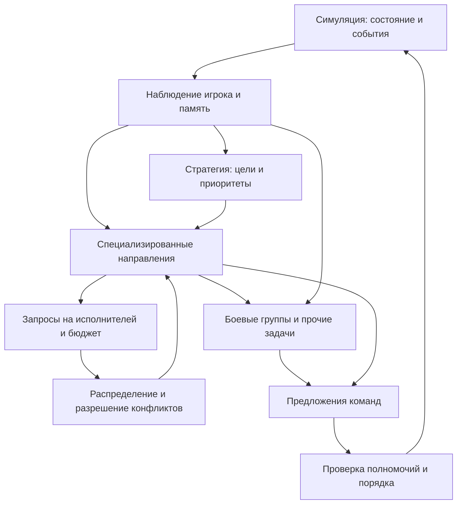

# Варианты архитектуры для OpenRTS

Это предложение для обсуждения, не новое решение проекта. Исходит из текущих возможностей, описанных в [020](../../decisions/020-players-economy-capture.md), [013](../../decisions/013-actions-and-production.md) и [010](../../decisions/010-orders-and-controls.md). Параллельная работа может изменить конкретные API; перед реализацией перепроверить код.

## Поток ответственности

Стрелки выражают данные и полномочия, а не обязательно очереди сообщений, потоки или отдельные сервисы. Малый прототип может быть обычным кодом без универсального фреймворка. ИИ — участник игры, а не владелец игровых правил: команда проходит существующую валидацию мира, а не меняет HP, ресурсы, положение или состояние производства напрямую.

**Наблюдение и память.** Один принадлежащий игроку снимок на определённом тике с разграничением наблюдаемых, своих и последних известных данных; данные immutable на время решения. Память имеет источник, время, устаревание и правила удаления. Shared blackboard полезен для фактов и намерений, но не является обходом контроля прав. FrameExchange предназначен для представления и не обещает достаточной или безопасной информации для ИИ: определить отдельную проекцию по настоящим потребностям и измерить её копирование. Передавать `FrameLease`/span между асинхронными вызовами нельзя.

**Стратегия.** Набор целей с приоритетом, сроком, ограничением риска и условием завершения; при чрезвычайном событии допустима внеочередная переоценка. Пример: «защитить строительную площадку; выделить до N бойцов; сохранить минимум C кредитов». Лейтенанты сообщают об успехе, невозможности и изменении условий. Обычная тактическая реакция не ждёт генерала. Наличие самого генерала полезно проверять сравнением с набором согласованных правил.

**Направления.** Начальные кандидаты: экономика/энергия, производство/постройки, военное управление; разведка становится самостоятельной по мере появления реальной видимости и целей разведки. Их границы определяются конкурирующими решениями, а не желанием иметь фиксированное число ролей. Сквозной пример: экономика сообщает о недостатке энергии → строительство предлагает электростанцию → арбитр сравнивает с срочной обороной → план финансируется → производитель реально ставит задачу → готовое строение размещается только при корректном месте.

**Группы.** Задача имеет ID, состав, назначение, цель, время пересмотра, условие отмены и исход. При гибели или захвате бойца состав очищается, при неподходящем пути группа сообщает о проблеме; разделение по профилю движения согласуется с имеющейся навигацией. Не создавать собственную физику или ожидать гарантии прохождения плотных заторов. Частота приказов ограничивается изменением цели/состояния: переподача Move может мешать существующей очереди и обходу. Ранний прототип может использовать AttackMove и имеющуюся автоатаку, а не покомпонентное управление каждым оружием.

## Конкуренция и жизненный цикл

**Юнит:** в каждый момент один управляющий владелец задачи; выдача/возврат/истечение прав определены явно. Предложенный стабильный выбор: жёсткий приоритет экстренной защиты, затем приоритет задачи, затем фиксированный ID задачи и EntityId. Срочное вытеснение должно сообщить прежней задаче причину и иметь предел или задержку возврата, чтобы избежать дрожания. Рабочий/инженер, временно отданный в оборону, возвращается при завершении или отмене; смерть, захват, недостижимость, смена стратегии и истечение времени снимают назначения. Человек и ИИ, управляющие одним игроком, требуют отдельной политики приоритетов, не подразумеваем автоматическое вытеснение.

**Бюджет:** стратегический резерв ИИ — локальное обязательство планировщика, не фактическое списание денег из PlayerState. Предложение включает ожидаемую цену, политику платежа, приоритет и срок. Нельзя дважды учитывать один платёж: при фактическом enqueue/списании резерв обновляется; при отмене, изменении цены, потере производителя или отказе освобождается/пересчитывается. Upfront, Progressive и OnCompletion дают разные будущие обязательства; ядро остаётся единственным авторитетом списания и возвратов. Денег может не хватить из-за другого легитимного действия; это нормальный отказ с повторной оценкой, не нарушение инварианта. Первой версии может хватить фиксированного резерва и приоритетной очереди вместо полноценной модели Petra.

**Приказы:** выбранные предложения проверяются на живого владельца, доступность действия, текущие ID, цель и границы; они принимаются в каноническом порядке. Содержимое очереди не стирается, когда новый приказ невалиден, согласно существующей семантике. У задачи должен быть наблюдаемый результат или тайм-аут; бесконечное повторение недостижимой стройки/цели скрывает ошибку.

## Расписание, детерминизм и масштаб

Рекомендуемая гипотеза: быстрые локальные реакции обновляются чаще, экономика и распределение — реже, стратегия ещё реже; события могут ставить задачи в очередь раньше срока. Числа тиков подбираются профилем, а не назначаются как факт. Десятки тысяч объектов не означают десятки тысяч стратегических агентов: общие агрегаты по областям, пространственные запросы и решения на группу сокращают повторение. Избегать сканирования всех пар; индекс MotionIndex — внутренний derived индекс со своим жизненным циклом, не обещанный готовый внешний API ИИ.

Для детерминированного встроенного режима: фиксированные фазы и тики наблюдения/применения, доменные ID и стабильный порядок ничьих, ограниченные целочисленные вычисления там, где они влияют на решение, собственное явно сохраняемое состояние RNG; никакой зависимости от порядка ECS, Dictionary или завершения jobs. Бюджет задаётся количеством обработанных задач/итераций, а не временем стены. Если работа делится между тиками, сохраняются курсор, очередь и версионирование входа; stale результат либо отбрасывается по детерминированному правилу, либо проверяется заново. Параллельные результаты сортируются и применяются после барьера на назначенном тике; пропуск дедлайна по времени CPU не должен менять результат. Проверять последовательный и параллельный режимы.

Есть два различных контракта реплея: **журнал команд** повторяет принятые действия с тиками и может не воспроизводить внутреннее мышление; **повтор генерации** требует того же ИИ, настроек, наблюдений, RNG и сохраняемого состояния планировщика. Для сохранения продолжающегося матча нужно сохранить либо восстановить достаточно состояния ИИ для дальнейших решений: задачи и их стадии, назначения, резервы, память, режимы, таймеры, RNG и частичные вычисления. Derived карты можно восстанавливать только если правило восстановления не меняет будущие решения. Форматы хеша и журнала здесь не предлагаются как уже реализованные.

## Внешний стратегический контроллер

Варианты: (1) in-process детерминированный стратегический модуль, (2) внешний процесс с асинхронным приёмом предложений, (3) MCP-адаптер поверх ограниченного API варианта 2. API даёт только разрешённое наблюдение игрока и ограниченный словарь целей; каждый запрос снабжён ID матча/игрока, тиком, версией и сроком. Проверка выполняется авторитетной стороной на момент применения. Внешний процесс не должен владеть `SimulationWorld`, удерживать lease или ожидаться на потоке симуляции. При отсутствии ответа продолжать предыдущую действительную стратегию до срока, затем перейти к явно заданному базовому поведению. Записывать решения и ошибки без утечки скрытого состояния. Точная сетевая безопасность и сериализация не проектируются заранее.

## Альтернативы и критерии выбора

| Подход | Плюсы | Цена и условия |
|---|---|---|
| Плоские правила + выделение юнитов | Малый объём, проще воспроизвести и отлаживать | Правила могут конфликтовать; полезен baseline |
| Гибрид стратегии, направлений и групп | Понятные цели, локальная автономность, независимая настройка | Стоимость координации и состояния; нужен измеренный выигрыш |
| Полный централизованный планировщик | Общий взгляд на конкуренцию целей | Большое пространство поиска, задержка, сложная модель и восстановление |
| Обучаемый/LLM стратег | Исследование необычных стратегий | Данные, стоимость, неопределённость, безопасность и воспроизведение; не условие первой версии |

Рекомендация — сравнить первые два на одном наборе сценариев; остальные рассматривать после доказательства потребности. Хороший ИИ должен быть не только сильным, но и понятным, настраиваемым и способным проигрывать интересным образом.
