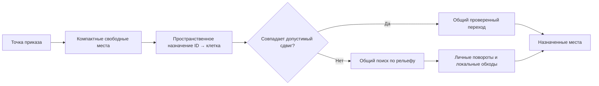

# Групповая навигация RTS: исследование и выбранная реализация

> Исторический этап клеточного исполнения от 3 ноября. Точные позиции и геометрическое движение заменяют его физические резервации: [решение006](../../decisions/006-exact-movement.md). Прежние замеры/хеши относятся к прежней версии.

3 ноября 2026 года. Решение для самостоятельного MIT ядра OpenRTS: desktop, наземная сетка 2.5D, фиксированные тики и ориентир на 10000+ участников. [Алгоритмы и статьи](algorithms.md), [реестр источников и доказательств](sources-and-evidence.md), [исходники RTS движков](engine-patterns.md), [разбор собственных ошибок и экспериментов](implementation-notes.md), [принятое решение](../../decisions/005-compact-group-navigation.md), [проверки](../../verification/006-compact-group-navigation.md), [замеры](measurements.json).

## Ответ и границы задачи

Обычный MoveGroup собирает участников в компактную область около клика. Исходные offsets, расстояния между юнитами и протяжённость толпы не сохраняются. Клик около центра разбросанной толпы должен собрать её, а не оставить на прежних местах. Предопределённые формации, например клин или квадрат с постоянными ролями, остаются отдельной будущей механикой.

Прежняя ошибка состоит из двух независимых частей. Выбор свободных мест по мере прибытия отдавал ближние места первым пришедшим и заставлял остальных проходить через стоящих. Резервирование исходной клетки до конца перехода дополнительно не позволяло соседним плотным рядам двигаться вместе даже при одинаковом направлении и скорости. Замена ведущего не исправляет ни семантику назначения, ни такие конфликты.

Выбраны заранее назначенные компактные места, пространственное сопоставление участников и мест, повторное использование поиска по рельефу и отдельное локальное разрешение конфликтов. Для частного случая одинаковых сдвигов используется согласованный пакет переходов. Это оптимизация движения, а не требование сохранять строй.

## Что и как исследовано

Исследование целевое, а не систематический обзор всей литературы. Изучены авторские описания coordinated movement, steering/flocking, tiled flow fields, continuum crowds, ORCA и cooperative pathfinding. Объём доступного полного текста каждого источника указан в [разборе алгоритмов](algorithms.md). Недоступные полные PDF не выдаются за прочитанные.

Прочитаны конкретные функции трёх движков: Recoil, 0 A.D. и Permafrost. Версии и ссылки закреплены commit SHA в [разборе исходников](engine-patterns.md). Для ключевых файлов агент повторно получил содержимое по SHA и сверил его с прочитанной версией. Референсные игры не запускались и не профилировались; их код не копировался в MIT ядро. Сведения о скорости чужой реализации не считаются результатами OpenRTS.

Исследование различает: наблюдение источника, инженерный вывод и нашу проверяемую реализацию. Уточнение пользователя об отказе от сохранения offsets учтено в итоговом выборе; режимы сохранения формации в источниках рассматриваются как альтернативы.

## Сравнение вариантов

| Подход | Что решает | Что не решает и почему не выбран единственным слоем |
| --- | --- | --- |
| A*/BFS к каждой личной цели | Индивидуальный статический маршрут | Повторяет большую работу для похожих запросов; не назначает места и не координирует контакты |
| Поле к свободным местам | Заполнение области толпой | Не хранит устойчивое соответствие участников местам; изменение источников меняет притяжение |
| Одно поле к точке/порталу | Общий маршрут | Без отдельного назначения мест создаёт очередь у одной клетки |
| Flow tiles / HPA* | Иерархия карты, порталы, повторное использование локального поиска | Само по себе не устраняет инверсию конечных мест и локальные заторы |
| Boids / steering | Separation, alignment, локальная согласованность | Cohesion к центру может вызвать лишнюю сборку; не заменяет глобальный путь и целевое назначение |
| ORCA / HRVO | Выбор допустимых локальных скоростей | Предпосылки непрерывной модели не переносятся автоматически на fixed-point клеточные резервации; не назначает места |
| Continuum crowds | Потоки, плотность, распределение нагрузки | Другая степень сохранения индивидуальных намерений; требует отдельной численной модели |
| Cooperative A* / WHCA* | Конфликты в пространстве-времени | Дороже локальных правил; ограниченное окно не гарантирует решение всех заторов |
| Перенос исходных offsets | Сохранение конкретного строя | Не собирает разрозненную толпу около её центра; отвергнут для обычного приказа |
| Пространственный matching + общий поиск | Компактное назначение без выбора по прибытии | Не гарантирует математически минимальную сумму путей; качество и пропускную способность нужно измерять |

## Выбранное сочетание

**Размещение.** Генерируется компактный набор из N клеток около якоря. На открытом участке используется близкая к квадратной упаковка, целиком сдвинутая внутрь карты. Если в ней есть рельеф, BFS подбирает N ближайших связанных свободных клеток. Закрытый якорь или недостаток связного места дают отказ всего приказа. Упаковка не становится постоянной формацией и не поддерживается вдоль пути.

**Назначение.** Источники и назначения рекурсивно делятся по пространственной оси на равные подмножества. В каждой ветви сортировки одинаковы, а равенство разрешается координатой и устойчивым ID. Оси выбираются по размерам каждого множества, поэтому перенос всей цели не меняет само правило разделения. Оценка текущей реализации — O(N log² N), память порядка N; кубическая глобальная матрица Hungarian не строится. Соответствие ID → конечная клетка задаётся на приказ; ограниченные локальные обмены при заполнении описаны ниже. Исходные offsets не сохраняются.

**Свободное движение.** Если все назначения дают одинаковый оставшийся сдвиг и следующий переход допустим для каждого, он проверяется и применяется пакетом. Внутреннее пересечение масок source/destination допустимо только при одинаковом кинематическом сдвиге: относительные расстояния на всей интерполяции остаются постоянными. Внешние участники, рельеф и освобождённые в этом тике клетки проверяются. Старые резервирования произвольных независимых траекторий не ослабляются. Если вся группа уже движется по-разному, такие же попутные цепочки собираются временно по направлению; зависимости проверяются от головы к хвосту. Это не постоянные формации или пространственные роли.

**Препятствия.** Если общего допустимого шага нет либо назначения требуют разных направлений, участники переходят к личным маршрутам. Один BFS лес по рельефу связывает компоненты; маршруты между личными источниками и целями переиспользуют это дерево. Прямые свободные L-участки обходятся без обхода дерева. Маршруты сжимаются в повороты. Lookahead пропускает старые углы и ведёт к самому дальнему видимому будущему повороту либо к конечной цели, когда между ними свободен прямоугольник. Иначе обход мог пронести юнита мимо обязательного угла, после чего он возвращался назад и создавал встречный поток. При продвижении маршрута отменяется устаревший обычный локальный обход.

Маршрут по одному дереву — компромисс повторного использования, а не общий кратчайший путь между любыми двумя клетками. В сложном лабиринте он может быть длиннее A*. Построение леса и выпуск личных маршрутов выполняются барьером; число потоков не определяет, кто начнёт раньше. При изменении рельефа лес и оставшиеся маршруты пересчитываются. Пространственные когорты и секторные flow tiles ещё не реализованы.

**Очереди и заполнение без запирания.** Простое ожидание попутного движущегося соседа не запускает новый BFS. Это освобождает ограниченный бюджет для реальных конфликтов. Попутного ведущего не оттаскивают назад; встречные конфликты используют продвижение по общему маршруту и ID.

После накопленного ожидания допустима передача цели стоящему соседу, который ближе к оставшейся цели. Набор мест сохраняется, а сумма Manhattan расстояний двух участников не увеличивается. Для двух движущихся соседей требуется строгое уменьшение суммы. Свободный прямоугольник подтверждает допустимость новых маршрутов. Это локальное улучшение сопоставления, а не новое глобальное назначение по прибытии.

Цикл до 16 соседей в конечной области также может передать цели по кругу без физического вращения; принимаются только варианты с меньшей суммой расстояний. Отдельная ограниченная фаза обслуживает такие конфликты, чтобы они не голодали за тысячами здоровых очередей. Размер будущего пути не ограничен искусственным радиусом: сосед может получить далёкую оставшуюся цель, если передача улучшает или сохраняет суммарную стоимость. Точная идентичность мест не является обещанием обычного группового приказа.

**Контакты.** Сохраняются ограниченные локальные обходы и уступание, с общим лимитом 64 поисков за тик, окном 17×17 и путём до 16 переходов. Они могут увеличить индивидуальный путь и не гарантируют отсутствие всех заторов. Внедрение float ORCA сейчас не выбрано: это смена модели движения, требующая отдельной верификации.

Отдельно проверен [вариант без физических локальных обходов своих в свободной области](data/monotone-convergence.json). После 131072 тиков оставались 825 приказов; вариант с ограниченными обходами завершал тот же сценарий раньше. Для воспроизведения сохранён [патч альтернативы](data/monotone-convergence.patch) и её исходные SHA-256. Поэтому запрет обходов не включён в выбранную версию. Монотонность логических переназначений не заменяет измерение качества полного движения.

## Проверка вывода и следующие решения

Проверки включают сбор разбросанной толпы, восемь направлений для регулярной группы, одновременное движение и прибытие 10000 плотных участников на свободной карте, проход сужения, удаление внутри согласованного перехода, смену цели, границы, рельеф, FPS и темп. Результаты перечислены в [верификации](../../verification/006-compact-group-navigation.md).

В окончательном длительном профиле все 10000 участников прошли четырёхклеточное отверстие и завершили приказы на тике 84594, без NoRoute. Это около 56,4 минуты при 25 Гц: завершение данного стресс-сценария подтверждено, но пропускную способность ещё нужно улучшать. Короткий профиль 100000 участников выявил другую границу: массовое назначение даёт тик около 200 мс. Эти результаты задают дальнейшую работу по иерархии, очередям и бюджету приказа; их нельзя подменять небольшим p95 установившегося движения.

Выбор нужно пересмотреть, если общие деревья дают чрезмерные обходы, назначение создаёт пересекающиеся потоки или построение маршрутов даёт слишком длинный тик. Для 10000+ участников важны длина пути, завершение, ожидание и стоимость массового приказа. Первая строка p95 при неподвижной толпе недостаточна. Длительные замеры и их ограничения сохраняются вместе с исходными хешами в [артефакте](measurements.json).

Следующие кандидаты — секторная/портальная иерархия, кэш общих частей маршрута и локальная кооперация в проходах. Размер пространственных когорт выбирается по профилю. Предопределённые формации и сохранение исходных смещений в этот выбор не входят.
