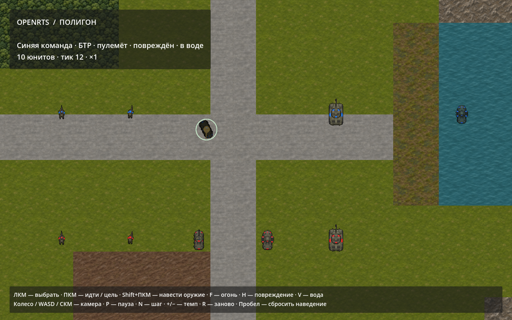

# Проверка слоя представления

Историческая проверка первой версии с однокадровой пехотой. Последующее дополнение: [кадровая ходьба](009-infantry-walking.md).

4 ноября 2026 года. .NET SDK 10.0.105, Godot 4.7.2 .NET, Apple M3 Max, OpenGL/Metal Compatibility.

Прошли **103 проверки**: 20 DeclarativeContent и 83 OpenRTS. Сборка без ошибок/предупреждений. Полный verify проверил импорт библиотеки, 5 определений юнитов, прежние кадры/движение/навигацию, workers/reverse jobs, 15/120 FPS, управление и новые представления.

Новые сценарии:

- Клонирование/сортировка семантических имён, ограничения 64/32, интервалы конечных дорожек.
- Замена Model binding не меняет игровой fingerprint/хеш.
- Движение, отдельное наведение, выстрел и два постоянных состояния одновременно; независимое завершение Body/Weapon.
- Быстрые переключения во время паузы, ошибки недоступных действий, удалённая цель, пропущенные кадры и закреплённые snapshots.
- Проверка Model ссылок, иерархий/циклов, размеров и соответствия Unit возможностям.
- Отдельный ресурс с тремя кадрами и весами 1/2/1 и 18/1/1 проверил линейное удержание, pingpong и ретайминг конечной длительности по реально выбранным текстурам, включая короткий последний кадр перед завершением.
- Godot загрузил 7 SpriteFrames, 7 текстур terrain и проверил RGBA-прозрачность исходных спрайтов. Для 10 сущностей рисуются 16 слоёв; для 10000 синтетических поз — 16000 слоёв при тех же 7 batch nodes.
- Пустой кадр скрывает экземпляры; последующие кадры переиспользуют ёмкость. Иерархия хранится в данных, не в тысячах дочерних Nodes.
- В обработчики ввода программно переданы выбор, Move, Aim, Fire, H/V, быстрые переключения и два одиночных шага. Это проверка настоящих обработчиков, не ручной длительный playtest.

В графическом Godot дополнительно проверены наличие синих/красных пикселей на областях одинаковых танков и сохранение экрана. Нативный и headless Godot совпали с чистым .NET headless на 12-м тике:

`D48EF1A4652124CD8A1E6734C1E33EB2FC63A3670BADC07A8AA89908084F3A0D`.



```sh
./tools/dev.sh run
./tools/dev.sh run --showcase
./tools/dev.sh run --showcase --verify-controls
./tools/dev.sh run --verify-presentation --capture=/absolute/path/presentation.png
./tools/dev.sh headless --showcase --ticks=12
./tools/dev.sh verify
```

ЛКМ выбирает любой юнит; ПКМ задаёт движение, на другом владельце — цель наведения. Shift+ПКМ задаёт точку/сущность наведения, Пробел снимает его. F — анимация выстрела, H — повреждённый вид, V — состояние воды для БТР. Наведение сохраняется при новом Move. R перезапускает полигон. Управление камерой/темпом/паузой сохранено.

Проверки 10000 поз относятся к отображению, а не новому массовому бою. В тестовом наборе один кадр на клип с bob/recoil/flash. Нет урона, снарядов, полного animation graph, 3D/voxel backend или настоящих циклов походки. Размер спрайта не меняет прежний круговой коллайдер. N1/разные физические размеры/права владельцев остаются отдельными этапами.

## Террейн для следующего N1

Сейчас это визуальные типы; только горы уже отображают существующую бинарную непроходимость. Остальные ограничения/скорости ещё не применяются.

| Тип | Предлагаемое правило N1 |
| --- | --- |
| Бетон/шоссе | Все, максимальная скорость |
| Трава | Танк без замедления, остальные медленнее |
| Грязь | Все медленнее |
| Вода | Только БТР |
| Лес | Только пехота |
| Болото | БТР и пехота, со снижением скорости |
| Горы | Никто |

Конкретные коэффициенты и отношение скорости к поисковой стоимости определяются при N1. [Решение](../decisions/007-presentation.md), [происхождение графики](../assets/README.md).
