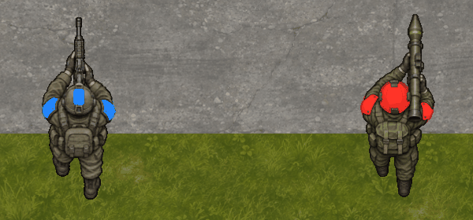

# Ходьба пехоты

4 ноября 2026 года. Классический четырёхкадровый цикл подключён к обоим пехотинцам. [Решение и ограничения](../decisions/008-infantry-walking.md).



GIF собран из четырёх снимков настоящего Godot renderer: слева автоматчик синей команды, справа ракетчик красной. Для сравнения фазы позы стоят в одной точке; это визуальный тест кадров, а не запись пройденного пути. Проверка фактического движения выполняется отдельно в Core.

- `tools/dev.sh test`: 20 DeclarativeContent и 84 OpenRTS проверки, без ошибок. Новая проверка подтверждает `move` при смещении, `idle` после прибытия и при приказе через полностью перекрытый проход.
- `--verify-presentation`: настоящие shipped-ресурсы выбрали ожидаемые регионы атласа на тиках 0/4/7/10/13; `idle` во все эти моменты удержал нейтральный кадр. Обе модели проверены отдельно. Сохранились проверки взвешенных клипов, pingpong, конечных дорожек и независимых состояний.
- 10000 синтетических поз: 16000 слоёв при 13 batch nodes, без узла на сущность. Проверено переиспользование буферов и пустого кадра. Это функциональная проверка структуры, не измерение производительности.
- Headless и графический Godot сохранили прежний хеш сценария на 12-м тике: `D48EF1A4652124CD8A1E6734C1E33EB2FC63A3670BADC07A8AA89908084F3A0D`.
- Полный `tools/dev.sh verify` прошёл: прежние direct/navigation сценарии, последовательные/параллельные workers, частоты отображения 15/120 FPS и обработчики управления. [Машинный отчёт и SHA-256 проверенных файлов](infantry-walk-verification.json).

```sh
./tools/dev.sh run
./tools/dev.sh run --verify-presentation --capture=/absolute/path/walking.png
./tools/dev.sh verify
```

Выберите пехотинца ЛКМ и задайте путь ПКМ по пустой местности. Колесо приближает камеру; P ставит паузу, N делает тик, +/− меняют темп. Захват в режиме проверки сохраняет общий экран и четыре соседних `*-walk-N.png` с крупным планом фаз.

Подготовка атласов воспроизводится `python3 tools/prepare_infantry_walk.py` с установленным Pillow 13.0.0. Входные листы сохранены в docs/assets/sources; игровые файлы — в sandbox/assets/units. [Промпты и контрольные суммы](../assets/infantry-walk.json). Новых API/игровых зависимостей нет. Длительный ручной playtest и профиль FPS массовой анимированной армии не выполнялись.
