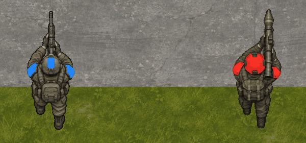

# N1: проверки грунта и Locomotor

Часть поведения назначения цели заменена [приказами и RTS-управлением](011-orders-and-controls.md): недоступный клик теперь корректируется. Этот документ сохраняет результаты и границы исходного N1.

4 ноября 2026 года. .NET SDK 10.0.105, Godot 4.7.2 .NET, Apple M3 Max. [Архитектурное решение](../decisions/009-terrain-locomotors.md).

Полный `tools/dev.sh verify` прошёл: **116 проверок** (20 DeclarativeContent + 96 OpenRTS), Godot/headless parity, последовательные/параллельные/reverse jobs, прежняя навигация на 10000 объектах, частоты отображения 15/120 FPS и управление.

Двенадцать сценариев N1 проверяют полный YAML-профиль и fingerprint; связность по четырём специальным покрытиям и её инвалидацию; обратный Dijkstra против независимого O(V²) oracle на случайных картах; цену выше Int32; ключи разных профилей, бюджет и FIFO; фактический объезд дорогого грунта без опасного сглаживания; дробную скорость; transit-only проход, запрет целей и Spawn; геометрию тела у воды; смешанные группы; хеши weighted point orders при 1/4 workers и reverse jobs; отклонение остановки прямо на текущем transit-only sample; общий поиск для 10000 участников. Старые сценарии тиков/packed removal/движения/отмены сохранены.

## Полигон

```sh
./tools/dev.sh run
./tools/dev.sh headless --showcase --ticks=12
./tools/dev.sh verify
```

Выберите юнита ЛКМ, задайте путь ПКМ. В HUD видны грунт и текущий множитель скорости. Для проверки различий отправьте пехоту в лес, БТР в воду, танк к этим же точкам; затем сравните движение по бетону, траве и грязи. Недопустимый новый приказ сохраняет прежний допустимый маршрут. V по-прежнему вручную переключает визуальное состояние воды; N1 сам не назначает графические состояния по имени грунта.

| Покрытие | Пехота | БТР | Танк |
| --- | --- | --- | --- |
| Бетон | 100% | 100% | 100% |
| Трава | 75% | 75% | 100% |
| Грязь | 50% | 50% | 62.5% |
| Вода | Нельзя | 62.5% | Нельзя |
| Лес | 62.5% | Нельзя | Нельзя |
| Болото | 37.5% | 50% | Нельзя |
| Горы | Нельзя | Нельзя | Нельзя |

Это диагностический баланс в [terrain.yaml](../../sandbox/content/terrain.yaml), не окончательные параметры игры. TerrainView и симуляция используют один источник раскладки карты; спрайт не задаёт проходимость.

## Нагрузка

Воспроизводимый сценарий находится в LocomotionChecks: 10000 сущностей, карта 240×132, полоса грязи с быстрым проходом, один компактный групповой приказ, восемь тиков. Замеряет только World.Step; создание мира/тел, хеширование и Godot исключены. Это короткий скрининг, без отдельного прогрева первого большого дерева, измерения steady-state боя или толпы в узком проходе.

Release, DOTNET_TieredCompilation=0: три дерева по профилям, ноль индивидуальных глобальных полей; первый тик **217.6 мс**, следующие семь — **8.9–12.4 мс**, суммарно **288.9 мс**. Аллокации восьми тиков — **9,037,200 байт**, включая создание маршрутов и общих деревьев. Это не zero-allocation режим и не гарантия производительности на другом оборудовании.

Первый массовый приказ пока превышает бюджет 40 мс при 25 Гц. Полное построение остаётся барьером; перенос длинного построения на детерминированные порции/иерархию относится к N4. Заявлять готовность любых боёв на 10000 юнитов по этому профилю нельзя. [Машинный отчёт](terrain-locomotors-verification.json).

## Поправка яркости ракетчика

Два прохода image_gen выровняли экспозицию полного листа ходьбы. Скрипт подготовки теперь использует целый исправленный лист; прежние источники сохранены. В Godot добавлена проверка относительного разброса средней яркости участка корпуса: прежний атлас давал около 9.6%, исправленный — около 6.1%, порог регрессии 7%. Это не требование одинаковых пикселей всех поз.



GIF показывает фазы на месте, чтобы сравнить освещение. [Промпты, SHA-256 и история замены](../assets/infantry-walk.json). Проверены RGBA, командная окраска и кадры обеих моделей. Длительный ручной playtest не проводился; общая гарантия разрешения заторов, разные размеры тел, fog и автоматические подгруппы остаются следующими этапами.
