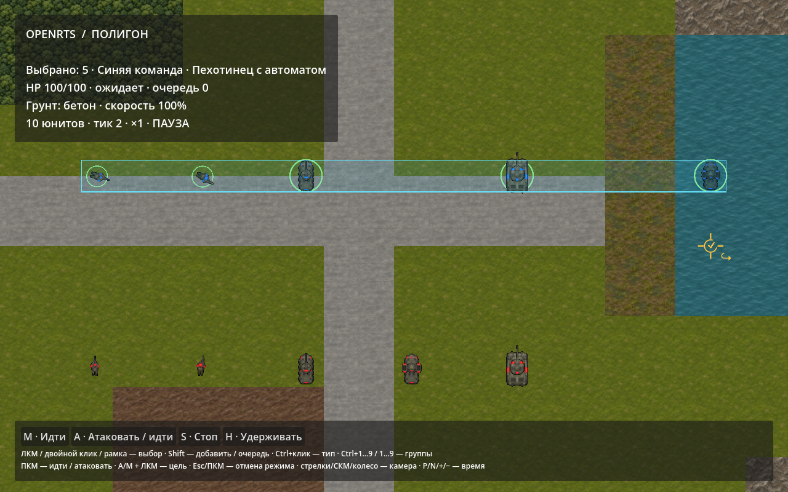
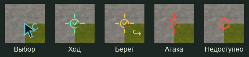

# RTS-управление, корректировка целей и приказы

4 ноября 2026 года. .NET SDK 10.0.105, Godot 4.7.2 .NET. [Решение](../decisions/010-orders-and-controls.md), [исследование](../research/rts-orders-and-controls/README.md).





Изображения получены из настоящего графического Godot. В GIF — короткие выборки анимаций векторного overlay, пока симуляция стоит на паузе.

## Управление

| Ввод | Действие |
| --- | --- |
| ЛКМ | Выбрать юнита; по пустому месту снять выбор |
| ЛКМ + движение | Рамка: свои юниты, чьи центры попали внутрь |
| Shift+ЛКМ / Shift+рамка | Добавить к выбору; одиночный клик по выбранному переключает его |
| Двойной ЛКМ / Ctrl+ЛКМ | Видимые юниты того же типа и владельца |
| Ctrl+A | Все свои юниты текущего опубликованного мира |
| Ctrl+1…9 / 1…9 / Shift+1…9 | Сохранить / вызвать / добавить контрольную группу |
| ПКМ | Move по земле, Attack по противнику |
| Ctrl+ПКМ | Принудительный Move вместо контекстной атаки |
| Shift+ПКМ | Добавить приказ в очередь |
| A, затем ЛКМ | AttackMove по земле, Attack по противнику |
| M, затем ЛКМ | Явный Move |
| S / H | Stop / HoldPosition |
| Esc / ПКМ в режиме назначения | Отменить назначение; Esc в обычном режиме снимает выбор |
| Пробел | Центрировать камеру по выбору |
| Стрелки / СКМ / колесо | Камера / перетаскивание / масштаб |
| P / N / + и − | Пауза / один тик / темп |
| R | Начать полигон заново |

Alt+ПКМ сохраняет прежнее ручное наведение основного выбранного юнита; F — его демонстрационный клип выстрела, K — косметическое повреждение, V — визуальное состояние воды у БТР. Эти debug-действия не заменяют боевые правила. В полигоне WASD для камеры отключены ради A/S приказов; диагностический режим сохраняет прежнюю WASD-камеру. Окно закрывается обычным системным способом; Esc больше не закрывает полигон.

```sh
./tools/dev.sh run
./tools/dev.sh run --verify-rts-controls
./tools/dev.sh run --verify-rts-controls --capture=/absolute/path/controls.png
./tools/dev.sh test --filter=Orders:
./tools/dev.sh verify
```

При захвате также создаются соседние `*-cursor-<kind>-<frame>.png` для проверки кадров. Их объединённый образец приведён выше.

## Проверки

Новые проверки Core охватывают берег своей компоненты вместо далёкого острова; только выбранных адресатов; Session.Issue против прямого исполнения журнала; неизменяемые IDs и FIFO; лимит 32 и сохранение очереди при невалидной замене; бой/возобновление AttackMove; windup/cooldown; Hold/одновременные смертельные попадания; препятствия для выстрелов; перепроверку queued-цели после Block/Destroy; выход с transit-only перед Hold; изоляцию целей разных Cohort; разрозненное выделение по островам; хеши боя при 1/4 workers/reverse jobs и packed removal; direct host без Godot; запрет уступания врагу.

Старые проверки проходимости обновлены под DestinationAdjusted: они по-прежнему проверяют тело, диагональные углы, стенки и места остановки. Прежний нулевой объём аллокаций в steady движении сохранён. Большой поток событий теперь проверяется на 70000 коррекциях цели. Vendor-проверки и старые worker/host/FPS сценарии сохранены.

Godot-сценарий `--verify-rts-controls` вызывает реальные обработчики ввода: click/shift/double/ctrl/рамку, контрольные группы, осмотр чужого юнита без выдачи приказа, A/M и отмену, Shift-очередь на двух адресатов, кнопку Stop, пакетные кольца и курсоры. Для double-click используется дополнительная синтетическая опубликованная поза того же типа: сам полигон содержит лишь одного юнита каждого типа на владельца. Это не выдача команды несуществующей сущности.

Прошли **132 проверки** (20 DeclarativeContent + 112 OpenRTS), полный verify, нативные/headless проверки Godot и 10000 пакетных колец выбора. Итоговые количества и SHA-256 сохранены в [машинном отчёте](orders-and-controls-verification.json). Профиль активного боя на 10000 вооружённых объектов и длительный ручной playtest не проводились. Не заявляется общая гарантия разрешения заторов, полноценная дипломатия/авторизация сети или набор специальных способностей.

Исправление запуска: тестовый KeyInput теперь принимает `shift` и передаёт его в InputEventKey.ShiftPressed. Ошибка CS1739 показала, что последняя прежняя GUI-проверка запускала старую DLL после неудачной сборки. Сборка, графический `run --verify-rts-controls` и полный verify повторены последовательно с остановкой при любой ошибке; актуальный результат записан в машинном отчёте.
