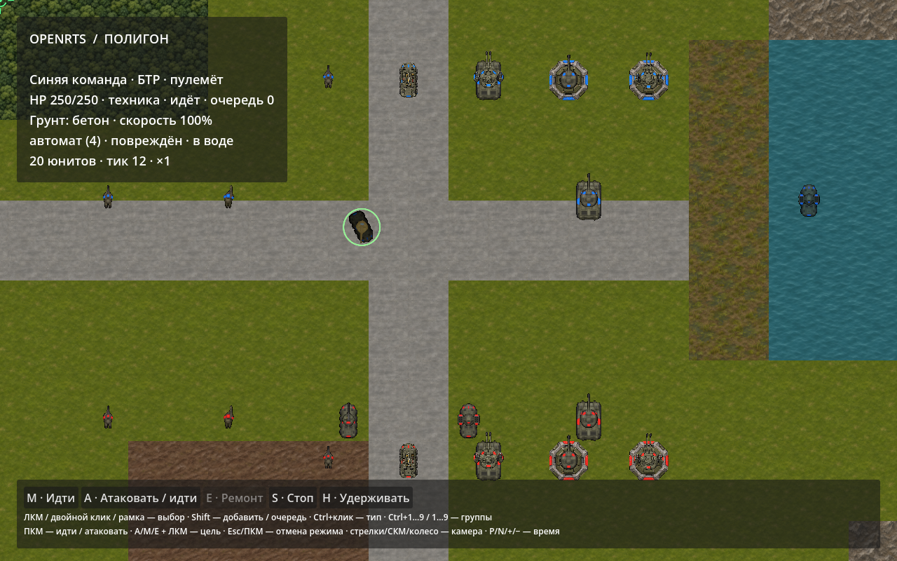
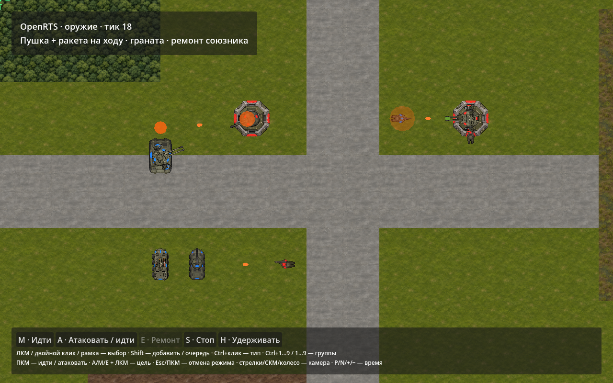
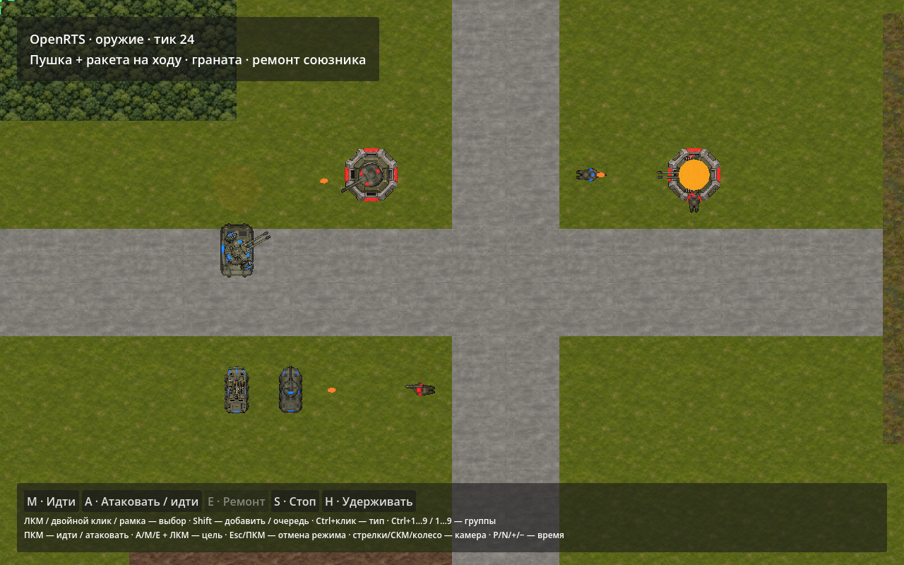
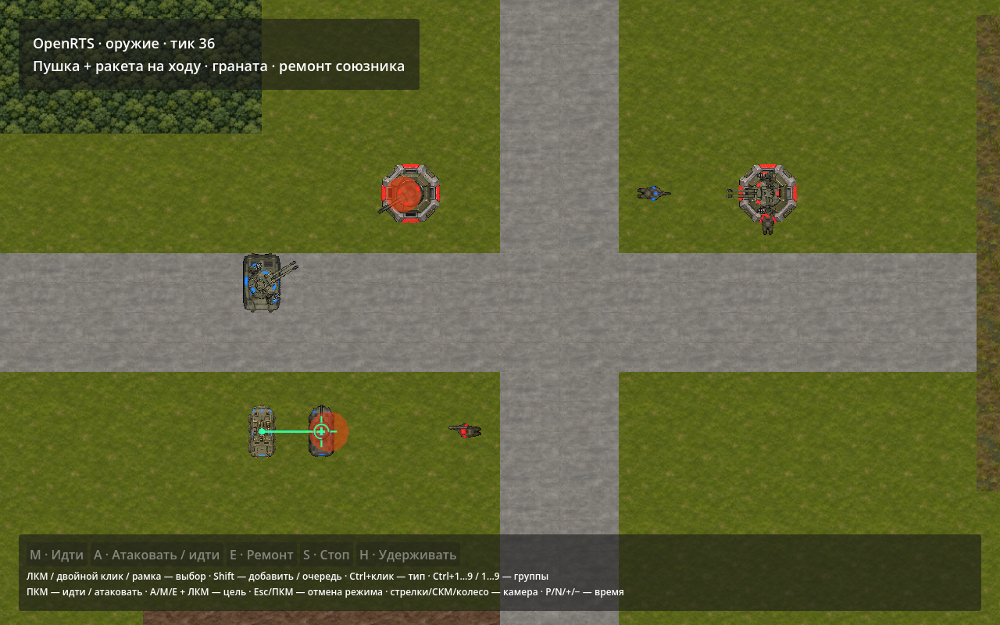

# 012. Оружие, снаряды и ремонт

Дата: 2026-11-04. [Архитектурное решение](../decisions/011-weapons-and-projectiles.md), [исследование](../research/weapons-and-projectiles/README.md), [машиночитаемый отчёт](weapons-and-projectiles-verification.json).

## Реализовано

В полигоне 20 объектов / 10 типов двух владельцев: автоматчик, ракетчик, гранатомётчик, два БТР, обычный и комбинированный танк, инженерная машина, два неподвижных ДОТа. Гранатомётчик пока использует спрайт автоматчика. Новые изображения созданы встроенным imagegen: [промпты, исходники и SHA-256](../assets/weapon-stage-art.json). Сторонний GPL код не импортировался.

- `weapons.yaml` задаёт пять способов воздействия, дальность, подготовку/серию/перезарядку, скорость/запас дальности снаряда, круговой AoE и матрицу брони.
- `units.yaml` назначает именованные mounts и разрешение стрельбы на ходу; у комбинированных танка/ДОТа два независимых орудия.
- `models.yaml` связывает семантические клипы и направление mount с частью модели; `effects.yaml` содержит только графические параметры. Палитра и карта передаются sandbox в адаптер.
- Приказ Repair доступен инженерной машине: **E + ЛКМ** по повреждённой союзной технике/ДОТу, кнопка UI или **ПКМ** по такому союзнику. Ctrl+ПКМ сохраняет обычное перемещение. Core повторно проверяет отношение, броню, дальность и HP.
- Для ДОТа доступны атака/Stop/Hold; A переводит его в выбор вражеской цели, без AttackMove. Переместить здание или попросить уступить нельзя.

Финальная интеграционная проверка также сверяет SHA-256 источников/нормированных новых спрайтов. После полного verify отдельно перепроверены крайний случай movement fixture из одних зданий и исправленная ориентация трассера.

Баланс демонстрационный. Урон автомата 12, modifiers Living/Mechanical/Building = 100/10/10 (12/1/1 за выстрел); пушка 70×10/150/90%; ракета 35×100/100/100%; граната 45×140/20/160%. Ремонт 18 HP по технике/зданиям. Модификатор округляется вниз, серии и задержки отдельно задаются в YAML.

## Что проверено

`./tools/dev.sh verify` завершился успешно: **20 проверок DeclarativeContent + 129 OpenRTS**, сборка без предупреждений/ошибок. В Core добавлено 17 боевых сценариев (`--filter=Weapons:`):

1. Валидность YAML, именованных ссылок и изменение fingerprint при изменении burst.
2. Точные интервалы серии/перезарядки; прерывание не пополняет магазин.
3. Задержанное попадание пушки и уход цели с зафиксированной линии.
4. Перехват другим объектом, быстрое пересечение с движущейся целью и остановка новой статической стеной.
5. Homing движущейся цели, конечный запас дальности и потеря цели.
6. Полёт после удаления стрелка.
7. Круговой AoE, три класса брони, исключение союзников и явный friendly fire.
8. Отказ ремонта врагу/живому, лечение союзника с clamp, завершение на полном HP; летальный урон не отменяется лечением того же тика.
9. Независимая стрельба двух орудий во время Move; отмена подготовки пешего орудия.
10. Неподвижность при индивидуальном/групповом приказе и отсутствие преследования; понятный отказ movement fixture из одних зданий.
11. WeaponPose/ProjectilePose в закреплённых кадрах после packed removal; ошибка при чтении disposed lease.
12. Равенство состояния боя с 1/4 workers и обратным порядком навигационных работ.
13. Два отдельных массовых сценария ниже.

Полный verify также сравнивает Godot/headless definitions и сценарии движения до 10001 объектов при 15/120 FPS, навигацию 10000 при разных workers, повтор журнала, камеру/темп, выбор/рамку/очередь/курсор/UI. Набор прежних проверок навигации не заменялся новыми боевыми тестами.

Native `--verify-presentation` теперь дополнительно проигрывает боевой сценарий: две установки танка стреляют на ходу, снаряды и попадания рисуются через три MultiMesh, граната взрывается, инженер ремонтирует союзника, режим/курсор ремонта доступны. Направление комбинированной башни сверяется с WeaponPose через фактический transform buffer MultiMesh; направление ремонтного луча — с отрезком от источника к цели. Проверка цвета учитывает half-float округление GPU. Основная спрайтовая проверка по-прежнему проверяет 10000 поз / 16000 слоёв в 16 batches, альфу, recolor, походку и состояния.

Конечный основной showcase на тике 12: 20 сущностей, хеш `81FB9004311E619CB023BE2E4A7FD7E15EE3F0EDE7A1D6B936AE4EC022417E59`. Форматы **direct 5 / navigation 9 / catalog 5**; отчёты этапов 010/011 исторические.

## Раздельные измерения

Apple M3 Max, .NET 10, Release, `DOTNET_TieredCompilation=0`. В каждом сценарии 8 тиков прогрева, затем 16 измеряемых `World.Step`, без создания мира, хеширования, публикации кадров и Godot. 5000 разнесённых пар / 10000 объектов двух владельцев, без движения/NavigationGrid. Это один короткий локальный запуск, не распределение p95/p99.

| Сценарий | Работа в окне | Всего 16 тиков | Среднее на тик | Аллокации |
| --- | --- | ---: | ---: | ---: |
| 10000 стрелков, hitscan | 52500 выстрелов и применение урона | 17,10 мс | 1,07 мс | 0 байт |
| 10000 стрелков + 10000 ракет | наведение/движение/swept collision; ракеты ещё не достигли целей | 40,79 мс | 2,55 мс | 0 байт |

В hitscan-сценарии range=2048, cooldown=3, windup=0, damage=1. В ракетном — cooldown=1000, speed=16, расстояние между противниками 1024: одна долгоживущая волна, без массовых попаданий в измеряемом окне. Разреженное расположение намеренно отделяет эту стоимость от толпы и pathfinding. Это **не** результат для 10000 движущихся бойцов в тесном проходе, 10000 одновременных взрывов или Godot с 10000 визуальных эффектов. Прежний пик первого массового приказа N1 остаётся отдельной проблемой.

Воспроизведение замера после `dotnet build tests/OpenRTS.Tests -c Release`: `DOTNET_TieredCompilation=0 dotnet run --project tests/OpenRTS.Tests -c Release --no-build -- '--filter=Weapons: 10000'`. Для рабочей среды проекта применяются те же DOTNET_CLI_HOME/NUGET_PACKAGES, что в tools/dev.sh. Сырые значения и параметры записаны в JSON отчёте.

## Кадры из Godot

Кадры сняты нативным Godot, не собраны из исходных ассетов. Визуально проверены альфа, командная окраска, общая башня, траектории, вспышки/AoE и зелёный ремонтный луч. Камера для боевой съёмки устанавливается отдельно от приближённого предпросмотра ходьбы.

## Текущие пределы

Ракета меняет направление мгновенно; граната имеет визуальную дугу без высотной физики. AoE равномерный и пока не учитывает укрытия/экранирование стенами. Статический удар отображается в начале заблокированного сегмента. Здания всё ещё круги радиуса 256 без footprint/navcell масок. Выбор целей и дипломатия простые; звук, дым/обломки и сложные ability effects не добавлялись. Система SpriteFrames не смешивает несколько skeletal-клипов: для общей детали суммируются простые импульсы, а базовый клип один. Это явные границы текущего этапа.
