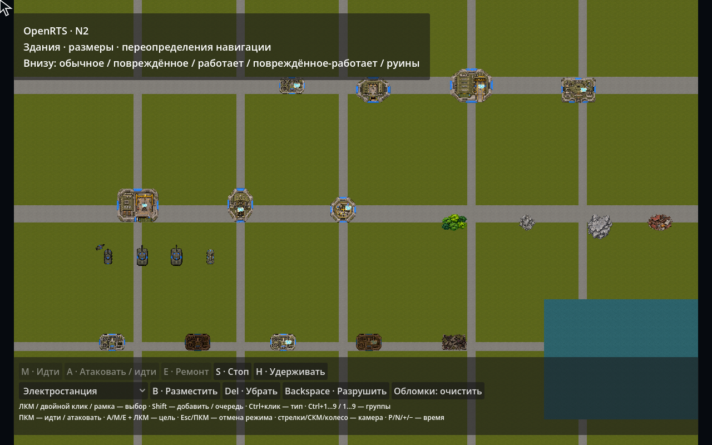
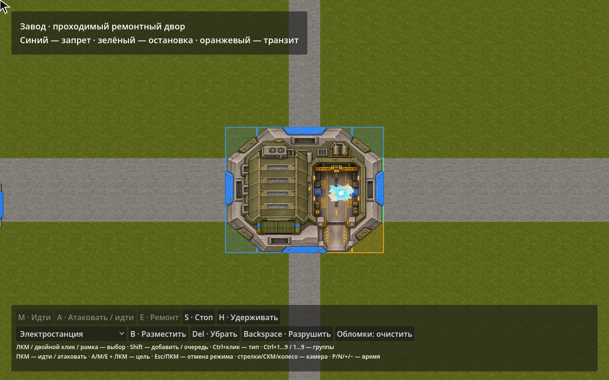
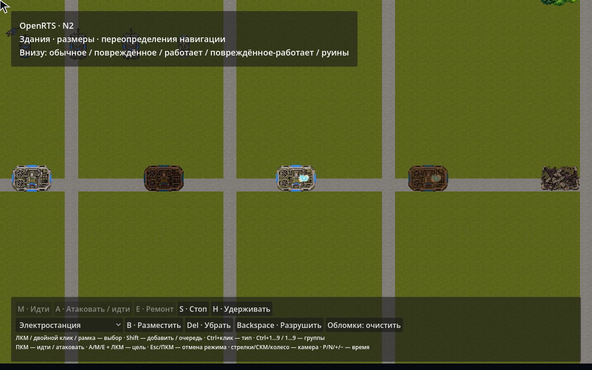
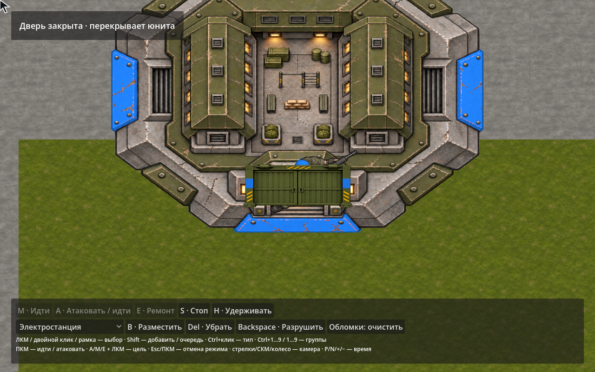
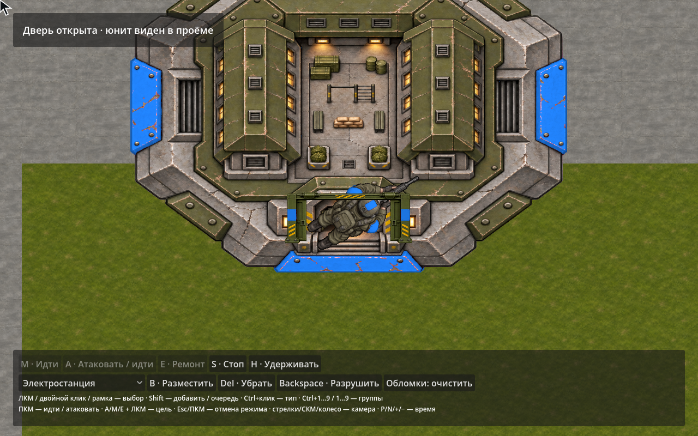

# 013. Здания, размеры и локальная геометрия

Дата: 2026-11-04. [Решение](../decisions/012-buildings-and-geometry.md), [исследование первичных исходников](../research/buildings-and-footprints/README.md), [машиночитаемый отчёт](buildings-and-geometry-verification.json).

## Полигон

```sh
./tools/dev.sh run
./tools/dev.sh run --showcase          # Прежний боевой полигон
./tools/dev.sh headless --buildings --ticks=24 --workers=1
./tools/dev.sh run --verify-buildings --capture=/tmp/buildings/final.png
./tools/dev.sh benchmark --size-benchmark --count=10000 --ticks=128 --workers=1
```

Новый default run загружает units.yaml + buildings.yaml и отдельные buildings-models.yaml. Core не знает эти ID, палитры, карту или кнопки; сценарием владеет sandbox. Семь новых сооружений: электростанция, бараки, завод с проходимым двором, HQ и отдельный радар, Construction Yard, шахта, нефтяная вышка. Четыре природных объекта: деревья, камни, скала, обломки. Старые ДОТы также получили footprint2×2. Суммарно в расширенном каталоге25 типов; неподвижные объекты не требуют фиктивной анимации движения.

На карте семь сооружений, четыре нейтральных объекта, пять мобильных тел и пять примеров состояния электростанции. На тике1 последний пример уничтожается; остаётся20 игровых объектов + визуальные руины. Деревья задают forest поверх дороги, скала — mountains; их удаление восстанавливает исходный грунт. Среди мобильных: круги160/384/640 и box640×320 (полуразмеры); арт и физический размер независимы.

Управление:

| Действие | Ввод |
| --- | --- |
| Выбор, двойной клик, рамка, очередь, контрольные группы | Прежнее RTS управление; Shift добавляет/ставит в очередь |
| Размещение | Тип в списке внизу → B → ЛКМ; Shift повторяет, Esc/ПКМ отменяют |
| Удаление выбранного здания без руин | Delete / кнопка «Убрать» |
| Разрушение и восстановление грунта | Backspace / «Разрушить» |
| Переключение работы | W у выбранного здания |
| Дверь / строительство / производство | O / C / F у выбранного здания |
| Ремонт союзника | Выбрать завод/инженера, E + ЛКМ или ПКМ по повреждённой механике/зданию |
| Навигационные клетки | Показываются при выборе здания/размещении: синий запрет, зелёная остановка, оранжевый транзит |
| Камера / время | Колесо, стрелки/СКМ; P, N, +/− |

Размещение — редакторская команда, не экономика. Preview проверяет геометрические границы карты; окончательную проверку совместимости с телами выполняет Core. Дверь сейчас только графическая, её открытие не меняет уже объявленную проходимость прохода. Рабочие эффекты, tint повреждения и анимации — данные адаптера; производство машин/очередь строительства пока не добавлены. Ремонт завода ручной в пределах дальности оружия, без автоматического обслуживания вошедшего во двор юнита.







## Проверки

`./tools/dev.sh verify`: 20 DeclarativeContent +151 OpenRTS, включая22 новых сценария N2; полная интеграция дополнительно проверяет Godot/headless, работников, FPS, ввод, эффекты и происхождение графики. Точный результат, хеши и параметры измерений — в JSON рядом.

Новые Core проверки покрывают:

- Валидацию размеров/Footprint/YAML и разделение движения/поражаемых клеток.
- Верхний/нижний слой, произвольное удаление, packed removal, скрытые базовые изменения и их хеширование.
- Проходимый двор без дополнительного центра-коллайдера, запрет остановки всем телом.
- Установку препятствия после готового пути, пересчёт и безопасный обход.
- Атомарный отказ размещения на живом теле; удаление платформы и восстановление stranded-юнита.
- Разные clearance кругов/box, частичные препятствия при terrain samples512/1024, округлённые углы.
- Уклон, ступень, глубину и elevation поверхности.
- Дальность до ближней границы, muzzle/aim, попадание в переднюю часть большой цели, найденной по extents.
- Splash по размеру тела и нескольким клеткам без повторного урона одному объекту.
- Смерть со снятием навигационного stamp, forest на road с разной достижимостью пехоты/танка.
- Swept безопасное движение разных радиусов, шаг групповых целей по размеру.
- Равенство динамических сценариев с1/4 workers и reverse jobs; неизменяемость уже опубликованной grid.

Исторические тесты обновлены там, где намеренно изменилась семантика: мелкая terrain cell теперь допустима при проверке полного тела, а blocked конечная точка корректируется к ближайшей доступной области. Курсор пропускает неподвижные объекты при проверке Move для смешанного выбора; resolver безопасно возвращает отсутствие stopping terrain при исходной точке внутри препятствия. Нативный ремонтный луч проверяется по фактическим boundary-точкам события, а не прежней дистанции между центрами.

`--verify-buildings` проверяет состав карты, Terrain stamps, снятие footprint у руин, selection по границе, anchor размещения, трансформ вращающегося радара, цвета/состояния и UV дверей, порядок накладывающихся зданий, опережающие события смерти, смешанный выбор зданий/юнитов и альфу всех15 новых PNG. 10000 building poses используют фиксированные35 batches/узлов представления; это проверка числа узлов и буферов, не замер FPS10k зданий.

В нативном OpenGL renderer проверены пиксели перекрытия двери: **закрыто2 / открыто53** синих пикселя пехотинца в тестовой области. Скриншоты показывают один и тот же проём/юнита; меняется только дверной overlay.





## Измерение N2

`--size-benchmark` создаёт10000 объектов четырёх размеров в независимых рядах с шагом2048, карту216×240 terrain samples и индивидуальные16-клеточные прямые приказы. На тике20 ставится здание2×2 на части маршрутов. Это измерение размеров/геометрии и динамической инвалидации, **не плотной толпы, боя или FPS**. JIT прогрет на отдельной маленькой карте, TieredCompilation=0. Инициализация, World.Step, snapshot и хеширование измеряются отдельно. P50/P95 исключают первый тик и тик изменения карты; расходы этих тиков не скрываются и записаны отдельно. Аллокации относятся к вызывающему потоку, не всем работникам процесса.

Финальные значения приведены в таблице ниже и JSON. Прямой exact-clear путь проверяется до построения глобального clearance. При необходимости обхода маска/компоненты пока строятся синхронно; изменение карты инвалидирует их целиком. Поэтому хороший steady tick не означает соблюдение40мс бюджета холодного запроса. Workers в этом сценарии не распараллеливают сам follower и синхронную геометрию; ускорение от их числа не обещается.

| Метрика | 1 worker | 4 workers + reverse jobs |
| --- | ---: | ---: |
| Инициализация, мс | 26.38 | 26.41 |
| Первый тик, мс | 82.30 | 83.16 |
| Тик установки здания20, мс | 280.52 | 241.71 |
| Остальные тики P50, мс | 26.59 | 26.77 |
| Остальные тики P95, мс | 30.27 | 30.09 |
| Snapshot, мс | 0.86 | 0.77 |
| Хеш состояния, мс | 18.27 | 17.31 |

В обоих запусках одинаковый хеш `D4B7568C0408A73A0F0C16E0E5F7F1E1441DFDC0A342D99E937F8E28A68F4868`. На тике128 остаются6 движущихся юнитов около добавленного здания; это не подтверждение полной пропускной способности или завершения всех приказов. За128 тиков вызывающий поток выделил около11,8MB. Это по одному запуску на Apple M3 Max/.NET10 Release, а не статистическое сравнение оборудования.


## Границы результата

Базовый N2 реализован для кругов, прямоугольников с осями мира, cell footprints и одного sampled наземного слоя. Шаг512 поискового графа ограничивает полноту нахождения узких извилистых проходов; физическая проверка при этом остаётся точной для поддерживаемых shapes. Произвольные полигоны, вращаемые коллайдеры и многоуровневые мосты не реализованы.

Глобальная композиция слоёв и инвалидация, холодные компоненты, перераспределение перегруженных групп и гарантии разрешения заторов остаются задачами N4/последующих этапов. Дальность и uniform splash используют размеры, но не полноценный3D LoS/высоту стен/пробитие. Детализированные damaged-спрайты и реальное производство могут добавляться независимо от навигации. Новая графика создана встроенным imagegen; [промпты/источники/SHA](../assets/buildings-art.json), GPL код не импортировался.
