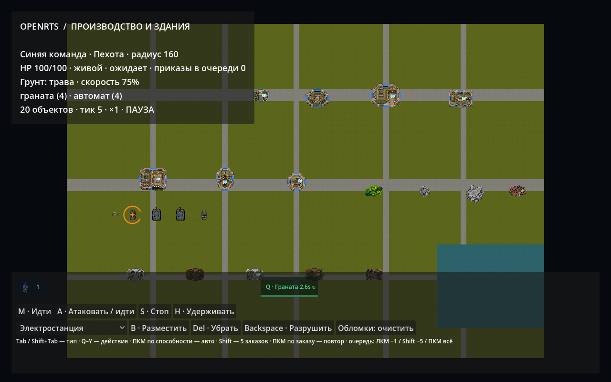
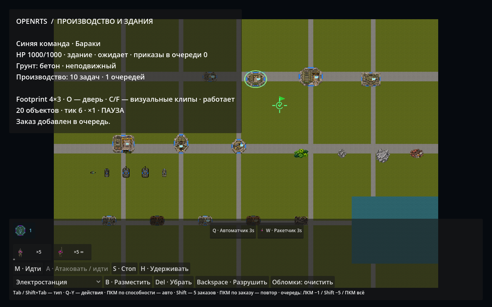
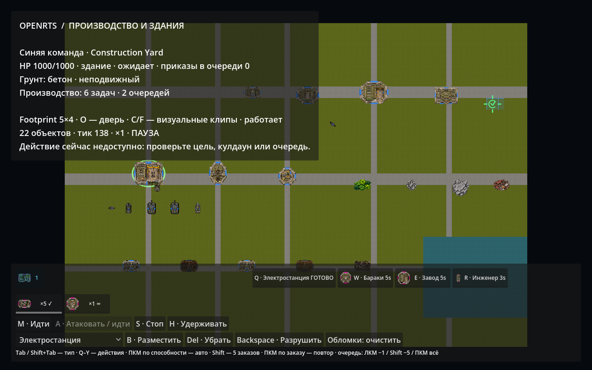
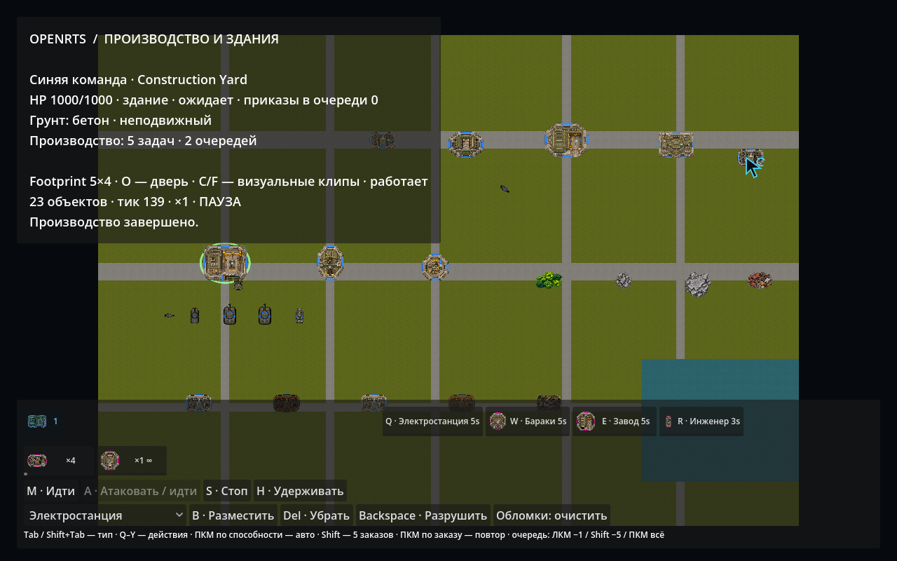

# 014. Способности и производство

Дата: 2026-11-05. [Архитектурное решение и схема YAML](../decisions/013-actions-and-production.md), [машиночитаемый отчёт](actions-and-production-verification.json).

## Запуск и действия

```sh
./tools/dev.sh run                         # Здания, производство и разные размеры
./tools/dev.sh run --showcase              # Противники для проверки гранаты/ремонта
./tools/dev.sh run --verify-actions --capture=/tmp/actions/final.png
./tools/dev.sh headless --production --ticks=160 --workers=1
./tools/dev.sh run --verify-production --workers=4
./tools/dev.sh verify
```

В боевом каталоге теперь9 типов и20 объектов: отдельный grenadier удалён, его места заняли обычные автоматчики. В расширенном каталоге зданий24 типа. Граната — зарегистрированная способность автоматчика и наследующего его light-infantry; ремонт — способность инженера и завода. Оба действия изначально без autocast. Оружейные параметры и перезарядка остались в weapons.yaml.

| Выбор / действие | Управление |
| --- | --- |
| Панель активного типа | Иконка типа с количеством; Tab вперёд, Shift+Tab назад |
| Граната автоматчика | Q / ЛКМ по кнопке, затем ЛКМ по местности или врагу |
| Ремонт инженера | Q / кнопка, затем повреждённый союзник; контекстный ПКМ также выбирает одного исполнителя |
| Автоматическое применение | ПКМ по кнопке способности, зелёное выделение и ↻; повторный ПКМ выключает |
| Заказ пехоты | Выбрать бараки; Q — автоматчик, W — ракетчик |
| Заказ техники | Завод: Q — БТР, W — большой танк, E — ремонт |
| Строительство | Construction Yard: Q — электростанция, W — бараки, E — завод, R — инженер |
| Пакет заказов | Shift+кнопка/хоткей —5; распределяются по самым коротким очередям выбранных зданий |
| Возобновляемые задачи | ПКМ по строительной кнопке —1 повторяемая; Shift+ПКМ —5 |
| Снять задачу из стопки | ЛКМ −1, Shift+ЛКМ −5, ПКМ — всю стопку |
| Точка выхода | ПКМ по местности / M+ЛКМ для выбранного производителя, на карте флаг |
| Готовое здание | ЛКМ по кнопке с «ГОТОВО», затем размещение; Esc/ПКМ отменяют только наведение |

Стандартные M/A/S/H, выбор/рамка/группы и камера сохраняются. Кастомный хоткей имеет приоритет, в том числе над отладочной W здания. Редакторская B по-прежнему создаёт объект напрямую; она не расходует готовую задачу и предназначена для навигационных тестов. Реальное C&C размещение активируется готовой кнопкой и подтверждается Core.

UI показывает иконки, количество, autocast, оставшийся cooldown, прогресс и готовность. Для группы кулдаун кнопки — минимальный среди выбранных исполнителей; один приказ расходует одну способность, а не весь отряд. Новейшие ожидающие заказы снимаются первыми, чтобы один клик не терял активный прогресс. Готовое здание снимается, когда до него доходит отмена его стопки.

Бараки/завод открывают дверь при фактическом выпуске. Construction Yard строит здания и инженеров в двух независимых очередях. Рабочие состояния публикуются из активной очереди. Если выход занят, готовый юнит остаётся в задаче до допустимого размещения, без наложения на другого юнита.

## Проверки

Новый набор: **6 Actions +11 Production**, в дополнение к прежним151 OpenRTS и20 DeclarativeContent. Полный verify также повторяет старые навигационные/боевые/графические сценарии. Итоговые результаты, число тестов, версия правил, хеши и проверенные файлы записаны в JSON рядом.

1. YAML наследует Buildable и переопределяет цену/длительность. Изменение Label/Hotkey не меняет gameplay fingerprint; неизвестный продукт и невалидная очередь отклоняются.
2. Из20 получателей вручную стреляет один, следующий приказ выбирает следующий готовый ID.
3. Граната в точку наносит splash, выключенная способность не становится обычной атакой, повтор приказа не сбрасывает cooldown.
4. Autocast независим по юнитам/владельцам; автоматический ремонт выбирает повреждённую союзную механику.
5. `Session.Issue(UnitActionKind.Ability, Action: ...)` сохраняет Action ID в журнале и выбирает одного исполнителя в worker-потоке.
6. Несколько производителей получают rally без попытки искать маршрут пустой мобильной группы; packed removal первого производителя сохраняет очередь второго.
7. Рабочий семантический state возникает/исчезает из очереди, без залипания после завершения.
8. Переопределённые cost/duration попадают в задачу, placement range считается по границам, выпуск запускает semantic ExitAnimation.
9. Batch5 делится3/2 между равными очередями по стабильному ID.
10. Независимые очереди работают параллельно; готовое здание ждёт, невалидное размещение сохраняет разрешение, валидное снимает его и меняет навигацию.
11. Повторы перемещаются в хвост с новыми ID; отмена1/всей стопки ограничена выбранным действием/режимом.
12. Заблокированный выход удерживает задачу и повторяет попытку после изменения карты.
13. Лимит очереди, rally произведённого юнита, уничтожение производителя и lifetime закреплённого TaskPose lease.
14. Прямой и threaded журнал, workers1/4 и обратный порядок работ дают одинаковое состояние.

Нативный `--verify-actions` проходит живой ввод в приостановленную Session:

- Tab/Shift+Tab, клик на тип и немедленный выбор инженера + Q в одном кадре.
- Временное UI переопределение Q→A: кастомное действие выигрывает у стандартной атаки без изменения fingerprint.
- Регистрация/выбор курсора, RMB autocast, фактическая перезарядка и полоска cooldown.
- Shift5 обычных и повторяемых задач, две стопки и все три вида отмены.
- Rally по ПКМ, параллельная очередь инженера и здания, фактический выпуск двух юнитов.
- Невалидное размещение готового здания, сохранение задачи, успешное размещение и ровно одно расходование.

Преобразование screen→world в нативном renderer может округлиться на одну fixed-point единицу. Поэтому rally произведённого юнита сравнивается с реально принятым rally производителя; отдельный Core тест проверяет точную числовую команду. Это не допуск на коллизии или прогресс задач.

`ProductionScenario` — один и тот же журнал на160 тиков для headless и Godot: пехота, готовая электростанция, rally, autocast и ручная граната. В финале23 игровых объекта и3 оставшиеся задачи. Сравниваются полный StateHash и конечный опубликованный кадр. Проверка не ограничивается UI событиями.

## Нативные кадры









## Ограничения

Экономика отключена: Cost и Payment — данные для будущего Player/ресурсного слоя, без проверок средств и возвратов. Способности пока используют оружейные эффекты, без произвольных скриптов/бафов. Исследования/апгрейды ещё не имеют собственного результата задачи, но могут получить отдельную именованную очередь. Проходимость визуальной двери не переключается её анимацией.

Поиск свободного выхода ограничен шагом256 и радиусом очереди; полный throughput фабрик не заявляется. Строительное размещение использует глобальную инвалидацию N2, её массовый пик остаётся N4. В этом этапе нет нового замера10000 одновременно производящих зданий; старые показатели N2/боя не переносятся на такую нагрузку. Иконки переиспользуют текущие Model/SpriteFrames, новые изображения не генерировались.
