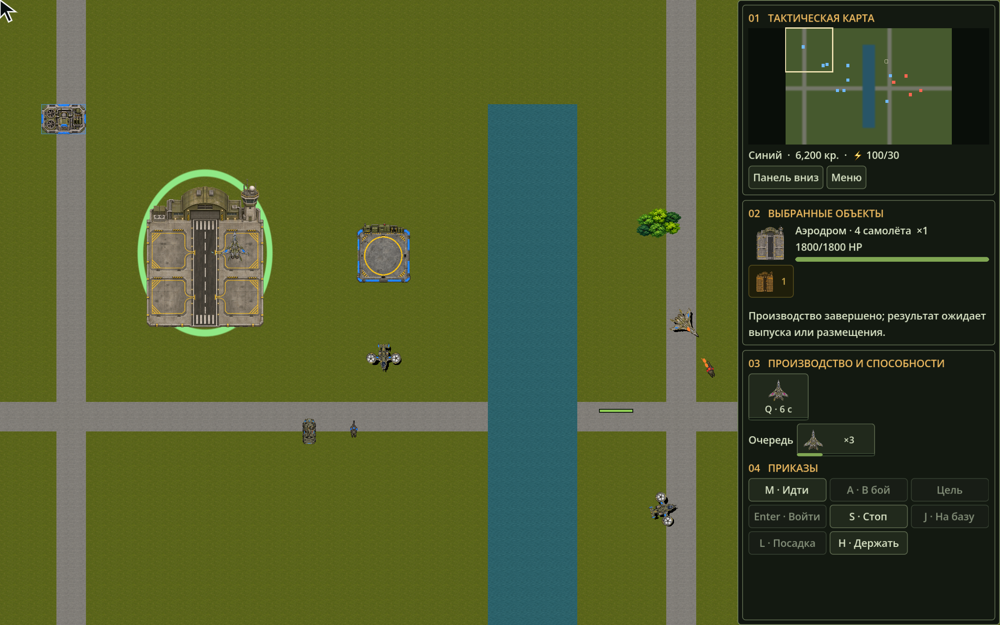

# Проверки первой реализации авиации

9 ноября 2026 года. [Контракт и ограничения](../decisions/032-aviation-and-target-categories.md). Основа до изменений — `3ae082fcdc83e68b7266016152f82329a157c643`.

## Функциональные результаты

Debug-сборка решения и Release-сборка проверок прошли без предупреждений. Полный Release-прогон — **291 проверка OpenRTS, 0 ошибок**. Отдельно прошли 20 проверок DeclarativeContent. Обычный `dev.sh build` в ограниченном окружении остановился на restore, сборка выполнена с `--no-restore` на существующем кеше пакетов. Новых зависимостей движка нет.

После последней оптимизации hash ячеек повторены 17 авиационных, 20 проверок по фильтру Weapons и 22 по N2, все без ошибок. Повторное сравнение 269 наземных снимков и 600-тиковый сценарий на трёх вариантах хоста также сохранили прежние результаты.

17 сценариев в [AviationChecks](../../tests/OpenRTS.Tests/AviationChecks.cs) проверяют категории и исключения, валидацию YAML, перелёт стены без наземной блокировки, ожидание занятой посадки, отмену без телепортации, сохранение ID/HP, допуск ПВО, высотное попадание мимо наземного тела, Stop самолёта, обслуживание и повтор атаки, потерю базы, 1/4 workers и старый FrameLease, вместимость четырёх стоянок, последовательный доступ к полосе, возврат на стоянку, установившиеся аллокации, высадку после касания, безопасный Spawn, независимость наземного графа от definitions авиации и отказ для неподдерживаемой переменной высоты.

Проверка на 1000 аппаратов после прогрева измеряет 32 тика свободного полёта и получает 0 выделенных управляемых байт на основном потоке. Это результат конкретного сценария, не гарантия для всех боёв и посадок.

## Наземная совместимость

До обновления golden traces выполнено отдельное сравнение исходного commit и текущего кода. Сравнивались события, команды, сущности, оружие, снаряды, задачи, игроки и строительные проекты после каждого тика. Из сравнения исключён StateHash, поскольку изменились определения и формат. Численные UnitType заменены стабильными именами. Неиспользуемое поле UnitType у не-Spawn команд исключено, поскольку добавление airfield меняет значение имени типа с ordinal=0 в полном каталоге.

Совпали **269 снимков пяти сценариев**. Для временной сборки исходной версии потребовались явные ссылки на те же Core и YamlDotNet, без изменения C# алгоритмов.

| Сценарий | Снимков | SHA-256 нормализованной трассы, одинаковый до/после |
| --- | --- | --- |
| direct | 25 | `2CBF0C108E45FEF51CDA45C1A5FA97EB8048A918D76216DB4EE3EC4B8FE9BDB6` |
| navigation | 33 | `E2BAE562D3CCC18788AF7D7C56106A77A2A0ABB6EB1883538527A0C57FC819B0` |
| combat | 25 | `91D8089352E8FED4FD39B6E3FF810E453EFEDDE727748FB66F9DFBE001A0F486` |
| buildings | 25 | `3915874D40D03B73E6AFC0C2E6739677636D4ED3BB558ACB86278170C7302E22` |
| production | 161 | `BD45804A46A5090615B1887F8C7B755B250DD0011A74150337EA2CB5F5A34AAF` |

При сравнении обнаружено и исправлено влияние размера тела неиспользуемого самолёта на наземный clearance-граф. Для этого добавлена самостоятельная регрессия. Golden traces обновлены для формата 28/каталога 13 после сравнения поведения.

## Хосты и отображение

Общий [сценарий авиации](../../sandbox/Scenarios/AviationScenario.cs) использует одну карту в headless и Godot. В нём есть вылет, производство, ПВО, воздушная атака и возврат. На 600 тиках headless с 1 и 4 workers и Godot дали 14 живых объектов и одинаковый StateHash.

`D19E4046E816F1124D1D96728C7CC2DE5B6C90E6769CE907FAED0B8468DD5F7B`

Прошли `--verify-presentation`, включая 10000 спрайтовых поз, `--verify-actions` и `--verify-rts-controls`. В нативном Godot выполнен `--verify-aviation`, осмотрены аэродром, самолёт, площадка, конвертоплан, HUD и тени. Генерация четырёх основных изображений и отдельного ротора выполнена built-in imagegen. Источники, промпты и SHA находятся в [aviation-art.json](../assets/aviation-art.json). Подготовка — `tools/prepare_aviation_art.py`, с сохранением alpha.

В headless Godot окружение дополнительно печатает известную ошибку macOS при чтении системных CA. Игровые проверки завершаются PASS. Нативный запуск с доступом к оконной системе этой ошибки не показал. Кеш `.godot` не включается в изменения.



## Стоимость свободного полёта

Отдельный замер Release: Apple M3 Max, macOS 27.2, .NET SDK 10.0.105, `DOTNET_TieredCompilation=0`. Измеряется только `SimulationWorld.Step`: 32 тика прогрева, затем 64 тика, без навигационной сетки, боя, публикации кадров и хеширования. Это диагностический замер первой версии, не профиль готового боя.

| Аппаратов | Расстановка | p50, мс | p95, мс | max, мс | Аллокации основного потока за 64 тика |
| --- | --- | --- | --- | --- | --- |
| 1000 | разреженная | 0.8858 | 0.9682 | 0.9905 | 0 байт |
| 10000 | разреженная | 9.1758 | 9.8590 | 10.2887 | 0 байт |
| 1000 | исходно в одной точке | 2.1026 | 2.2340 | 2.2602 | 0 байт |

Параметры воспроизведения: мир 1048576×1048576, один `UnitDefinition` с `FlightDefinition()` и круглым телом радиуса 320, высота 1536, владелец 1. В разреженном варианте `columns=ceil(sqrt(count))`, позиция аппарата i — `(4096+i%columns*2048,4096+i/columns*2048,1536)`. В плотном все начинаются в `(100000,100000,1536)`. На тике 1 — `MoveAll` в `(900000,500000)`, затем прогрев и измерение. Первые вызовы публикации и хеша измерялись отдельно, но не считаются установившейся стоимостью из-за непрогретого кода.

Первый замер 10000 аппаратов дал p50=71.9149 мс. Отключение сортировки при отсутствии посадочных запросов не устранило скачок. Причина оказалась в hash для ключей MotionIndex: у упакованного Int64 стандартный hash сводил X/Y к XOR, создавая много совпадений в квадратной сетке. Добавлено перемешивание битов только для производного словаря ячеек; сравнение ключей и порядок обхода тел сохранены. После исправления p50=9.1758 мс, хеши всех трёх нагрузок совпали с предыдущими. Нулевая аллокация и этот результат не доказывают бюджет смешанного боя с боеприпасами и конкуренцией за базы — для него нужен отдельный профиль.

## Воспроизведение

```sh
./tools/dev.sh run --aviation
./tools/dev.sh headless --aviation --workers=1
./tools/dev.sh headless --aviation --workers=4
./tools/dev.sh run --verify-aviation
./tools/dev.sh test --filter=Aviation
```

В игровой сцене 12000 кредитов у каждой стороны. Аэродром и площадка производят соответствующие аппараты. ПКМ задаёт полёт, J возвращает на обслуживание, L выбирает место посадки VTOL. Самолёт садится через аэродром. Рамка, двойной клик, группы, AttackMove, очереди и rally используют прежний UI. Погрузка пехоты требует посаженного конвертоплана, выгрузка в точку сначала выполняет посадку.

Сложный рельеф, несколько полос, dogfight и массовая конкуренция за сотни площадок не заявлены проверенными. Производительность публикации, хеша и графики не следует выводить из проверки аллокаций Step.
